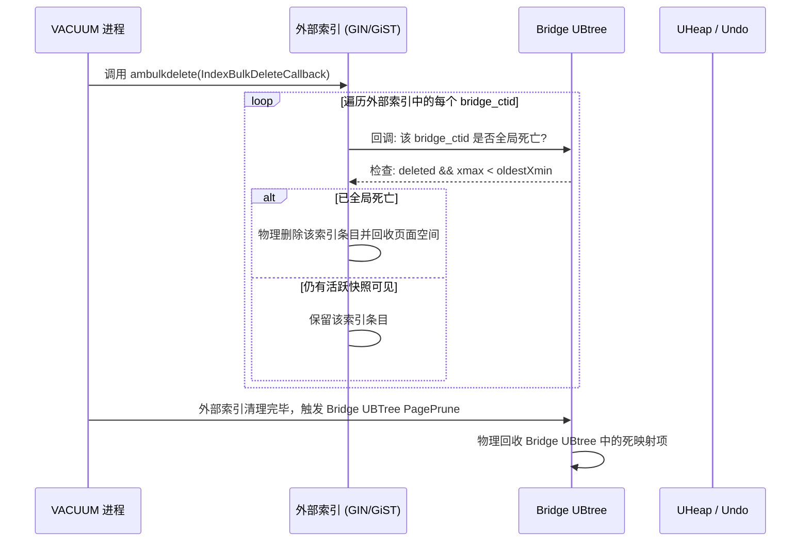

# openGauss Ustore 桥接索引 (Bridge Index) 架构设计方案

> **参考系统**：[OrioleDB (GitHub)](https://github.com/orioledb/orioledb)  
> **适用引擎**：openGauss Ustore (UHeap + UBTree + Undo)  
> **目标**：在 Ustore 存储引擎上原生支持除 UBtree 以外的所有 Heap 索引类型（包括 GiST、GIN、SP-GiST、BRIN、Hash、Bloom，以及向量扩展如 pgvector HNSW/IVFFlat）。  
> **落地实施计划**：👉 [阶段一详细实施计划 (MVP: Hash & GiST)](file:///home/fengyao/openGauss-server/bridgeindex/phase1_implementation_plan.md)

---

## 目录
1. [背景与核心问题剖析](#1-背景与核心问题剖析)
   - 1.1 Astore 与 Ustore 的架构与 MVCC 本质差异
   - 1.2 传统 Heap 索引在 Ustore 上的失效根因
   - 1.3 现有 UBtree 与 HNSW 改造的局限性
2. [OrioleDB 桥接索引 (Bridge Index) 机制解密](#2-orioledb-桥接索引-bridge-index-机制解密)
   - 2.1 什么是 Bridge Index
   - 2.2 核心组件与工作流
   - 2.3 OrioleDB 的关键工程经验与防坑指南
3. [openGauss Ustore Bridge Index 架构体系设计](#3-opengauss-ustore-bridge-index-架构体系设计)
   - 3.1 总体架构蓝图
   - 3.2 行定位器 (Row Locator) 与双向映射模型
   - 3.3 合成虚拟指针 (`bridge_ctid`) 生成器与崩溃恢复一致性
   - 3.4 伴随 Bridge UBtree 的内部生命周期管理
   - 3.5 读路径深度适配 (IndexScan 与 BitmapScan)
   - 3.6 写路径与事务回滚闭环 (Insert / Update / Delete / Rollback)
   - 3.7 空间回收与 VACUUM 联动闭环
4. [方案对比：Bridge Index vs. 逐一重写 Index AM](#4-方案对比bridge-index-vs-逐一重写-index-am)
5. [源码级改造清单与落地路径](#5-源码级改造清单与落地路径)
   - 5.1 解析器与系统目录改造
   - 5.2 访问方法层 (Index AM) 改造
   - 5.3 执行器层改造
   - 5.4 性能优化关键技术 (Scan-Level Cache)
6. [分阶段实施路线图 (Roadmap)](#6-分阶段实施路线图-roadmap)

---

## 1. 背景与核心问题剖析

### 1.1 Astore 与 Ustore 的架构与 MVCC 本质差异

openGauss 提供了两种行存储模型：
- **Astore (Append-Only Store)**：沿袭传统 PostgreSQL 堆表设计。每次 `UPDATE` 均在堆中追加一条全新的物理元组，分配新的 `CTID (BlockNumber, OffsetNumber)`，旧元组保留在原地并标记 `t_xmax`。多版本元组直接保留在数据页中，可见性判定完全下推至堆元组头部。
- **Ustore (In-Place Update Store)**：面向高并发 OLTP 场景的 Undo 型存储引擎。其核心特征是**原地更新**——当行更新发生时，旧版本数据被剥离写入 Undo 日志，堆页中的元组直接被新数据就地覆盖，物理 `CTID` 保持不变。

| 核心特性 | Astore (Heap 堆表) | Ustore (UHeap 堆表) |
| :--- | :--- | :--- |
| **更新行为** | 追加写新元组，产生全新 `CTID` | 原地更新覆盖旧值，`CTID` **通常保持不变** |
| **历史版本存放** | 堆数据页中（带来表膨胀与 VACUUM 负担） | 集中存放在独立的 Undo 日志空间 |
| **可见性判定位置** | 堆元组头部 (`t_xmin`, `t_xmax`, `infomask`) | UHeap 页面事务槽 (TD) + 事务回溯 Undo 链 |
| **索引项生命周期** | 索引只管插入 `(Key, CTID)`，无单行删除；死项由 `VACUUM` 批处理清理 | 期望支持 DML 单行实时失效（Retail Delete），避免索引无序膨胀 |
| **页面槽位复用** | 仅在整个页面被 Vacuum 清扫后复用 ItemId | 页面内实时空间整理 (`knl_pruneuheap`)，**槽位被极速复用** |

---

### 1.2 传统 Heap 索引在 Ustore 上的失效根因

PostgreSQL 与 openGauss 原生支持的索引访问方法包括 **B-tree、GiST、GIN、SP-GiST、BRIN、Hash**，以及向量索引 **HNSW、IVFFlat** 等。除 B-tree 在 Ustore 中被重构为 UBtree 外，其余索引均无法直接作用于 Ustore 表，根因如下：

```
传统索引假设：一个 CTID 严格对应一个不可变的物理元组版本
           ┌────────────────┐
           │ GIN / GiST 索引 │
           └───────┬────────┘
                   │ 存储 (Key -> CTID)
                   ▼
           ┌────────────────┐
           │ Astore 物理堆页 │  ---> 堆元组内包含 xmin/xmax，可独立判断快照可见性
           └────────────────┘

Ustore 现实：原地更新导致同一个 CTID 跨越多个版本；槽位复用导致幽灵指向
           ┌────────────────┐
           │ GIN / GiST 索引 │
           └───────┬────────┘
                   │ 存储 (Key -> 物理CTID)
                   ▼
           ┌────────────────┐
           │ Ustore 物理堆页 │  ---> 原地覆盖！旧版本已进 Undo；死行擦除后新行复用该槽位！
           └────────────────┘
```

#### 致命冲突点 1：原地更新导致的多版本覆盖（In-Place Overwrite）
若某行某列初值为 `"A"`，被事务更新为 `"B"`。在 Ustore 中，该行在物理页上的槽位 `(Block 1, Offset 5)` 未变。
若外部索引为 GIN/GiST：
- GIN 中仍残留 `("A", (1, 5))`；新插入项为 `("B", (1, 5))`。
- 当一个新快照查询检索 `"A"` 时，GIN 依然命中 `(1, 5)`。但当定位到 UHeap 页时，当前行最新内容已是 `"B"`。即使 Ustore 支持 Undo 历史回溯，该新快照本就不该看到历史值 `"A"`，从而产生大量的伪匹配和回溯开销。

#### 致命冲突点 2：槽位复用导致的幽灵匹配（Phantom Row on Slot Reuse）
Ustore 为控制膨胀，具有极其敏捷的块内重组机制（`knl_pruneuheap`）。一旦元组被删除且对应事务已提交，该元组被就地擦除，槽位立即空出并分配给后续的 `INSERT` 操作。
- 外部 GIN/GiST 索引因缺乏实时清理，仍保留指向旧元组的 `(Key_Old, (1, 5))`。
- 后续插入了一条完全无关的新元组，恰好分配到 `(1, 5)`。
- 检索 `Key_Old` 的查询通过外部索引会错误定位并提取到这条完全无关的新元组！

#### 致命冲突点 3：缺乏单行实时删除接口（Lack of Retail Delete）
Ustore 在执行 DML 时，如果发生元组删除或索引列更新，执行器层会调用 `ExecUHeapDeleteIndexTuplesGuts()`，遍历所有索引并执行 `index_delete(actualindex, values, isnull, tupleid)`。
- 传统 GIN（压缩的 Posting List/Tree）、BRIN（数据块范围摘要）在数学与数据结构设计上**天生不支持单行实时物理删除**。
- 强行在传统索引页面上打标 `xmax` 会破坏其紧凑编码，甚至导致树结构无法维护。

#### 致命冲突点 4：页面格式与事务恢复机制脱节
openGauss 的 UBtree 为了配合 Ustore，重新定义了页面格式与 XLOG 体系：
- 引入了 `UstoreIndexXidData`（`xmin/xmax`）或 PCR TD 槽位；
- 引入了基于 Undo 的回滚支持与 `IndexPagePrepareForXid`。
若直接对 GiST/GIN/SP-GiST/BRIN 等每个索引 AM 进行深度重构，必须重写每个索引的页面格式、并发控制、WAL Redo 和 Undo 回滚机制，工程量无法估量，且与开源生态完全割裂。

---

### 1.3 现有 UBtree 与 HNSW 改造的局限性

在 openGauss 现有代码中：
1. **UBTree / UBTree PCR**：通过在索引元组末尾附加 `IndexTransInfo`，或在叶子页分配 Page-level TD 事务槽位，成功实现了原地更新支持。但该模式仅适用于点对点映射的 B-Tree 结构，无法直接泛化到集合型倒排索引（GIN）或多维空间索引（GiST）。
2. **HNSW 原生尝试的痛点**：在 `hnswbuild.cpp` 和 `hnswinsert.cpp` 中，openGauss 曾尝试通过 `PageHeader->pd_upper -= sizeof(IndexTransInfo)` 为 HNSW 页面硬塞事务信息。但这种方式对于图形结构、剪枝逻辑以及并发删除极其脆弱，无法推广到其他索引。

---

## 2. OrioleDB 桥接索引 (Bridge Index) 机制解密

### 2.1 什么是 Bridge Index

[OrioleDB](https://github.com/orioledb/orioledb) 是专为现代硬件设计的 PostgreSQL 开源云原生存储引擎。OrioleDB 本身是一套纯粹的**索引组织表（Index-Organized Table, IOT）**，主表直接基于无锁并发 B-Tree 组织，由主键定位，堆中根本没有固定的物理 6 字节 `CTID`。

为了不放弃 PostgreSQL 丰富的非 B-tree 扩展生态（如 `pgvector` 的 HNSW、内置的 GIN、GiST、BRIN 等），OrioleDB 发明了 **Index Access Method Bridge（桥接索引）**。

桥接索引的核心思想是：**将传统外部索引与底层存储引擎解耦，在二者之间插入一个具备完整 MVCC/Undo 能力的桥接映射层。**

---

### 2.2 核心组件与工作流

OrioleDB 的 Bridge 架构由三大要素构成：

```
                    ┌───────────────────────────────────┐
                    │   传统外部索引 (GIN / GiST / HNSW)   │
                    └─────────────────┬─────────────────┘
                                      │ 存储: (IndexKey -> bridge_ctid)
                                      ▼
                    ┌───────────────────────────────────┐
                    │      Bridge Tree (内部桥接 B-Tree)   │
                    │      (基于 OrioleDB 原生 B-Tree 实现) │
                    └─────────────────┬─────────────────┘
                                      │ 映射: (bridge_ctid -> Primary Key)
                                      ▼
                    ┌───────────────────────────────────┐
                    │    主表主键 B-Tree (数据存储 + Undo) │
                    └───────────────────────────────────┘
```

#### 组件 1：合成虚拟标识符 (`bridge_ctid` / `iptr`)
- 外部索引只认标准的 6 字节 `ItemPointerData (BlockNumber, OffsetNumber)`。
- OrioleDB 引入全局单调自增的虚拟指针 `bridge_ctid`（由自增 64 位整型拆包打包为 Block + Offset）。
- **核心规约**：每次插入新行，或更新行中涉及桥接索引的字段时，**强制分配全新的 `bridge_ctid`**。这使得每个逻辑版本拥有全局唯一的 `bridge_ctid`，彻底规避了“原地覆盖”和“槽位重用”问题。

#### 组件 2：内部桥接树（Bridge Tree）
- 当表上创建第一个非 B-tree 索引时，系统自动在底层隐式创建一个伴随的 Bridge Tree。
- Bridge Tree 采用 OrioleDB 原生的 B-Tree 实现，以 `bridge_ctid` 为键，以 `Primary Key` 为值。
- **关键特性**：因为是引擎原生 B-Tree，它天然拥有页面级并发控制、事务 XID、Undo 日志生成以及回滚支持。

#### 组件 3：桥接扫描与 DML 流水线
- **读取（Scan）**：
  1. 扫描外部索引（如 GIN），获得一组匹配的 `bridge_ctid`；
  2. 桥接层拦截扫描结果，携带当前查询的 `Snapshot` 检索 Bridge Tree；
  3. 若 `bridge_ctid` 在该快照下不可见（已删除或未提交），**直接剔除**；
  4. 若可见，解出对应的 Primary Key，再前往主表读取实际数据。
- **写入（Insert）**：
  1. 生成新 `bridge_ctid`；
  2. 插入 Bridge Tree：`bridge_ctid -> PK`；
  3. 调用标准 `aminsert` 写入外部索引：`Key -> bridge_ctid`。
- **更新（Update）**：
  - 若未修改桥接索引对应列：外部索引与 Bridge Tree **完全无需写入**（零写开销！）。
  - 若修改了桥接索引对应列：在 Bridge Tree 中标记旧 `bridge_ctid` 删除（写入 Undo），生成新 `bridge_ctid` 写入 Bridge Tree，并向外部索引插入新键值。
- **删除（Delete）**：
  - 仅在 Bridge Tree 中将 `bridge_ctid` 标记删除（生成 Undo）。外部索引保持不动，后续由 VACUUM 异步回收。

---

### 2.3 OrioleDB 的关键工程经验与防坑指南

在 OrioleDB 的演进历史中，Bridge Index 经历过多次重要修复，为 openGauss 提供了极具价值的避坑参考：

1. **`bridge_ctid` 计数器崩溃恢复回拨问题**（*Crash Recovery Bug*）：
   - *问题*：早期版本中 `bridge_ctid` 计数器保存在内存中，崩溃重启后计数器从较小值重新开始递增，导致分配的 `bridge_ctid` 与崩溃前写入外部索引的历史项发生碰撞，触发唯一键冲突或数据错乱。
   - *经验*：高水位（High Water Mark）必须结合 WAL 与元数据页严格持久化，重启恢复后强制推进高水位。
2. **并发 DML 下的快照可见性一致性**（*Concurrent DML Visibility*）：
   - *问题*：并发事务删除某行时，外部索引扫描与 Bridge Tree 读写锁竞争可能导致读事务看到半更新状态。
   - *经验*：必须在 Bridge Tree 层复用引擎原生的行级 MVCC 判定逻辑，避免在外部索引层尝试做事务推断。
3. **VACUUM 期间的外部索引清理联动**：
   - *问题*：外部索引随着更新会积累死 `bridge_ctid`，若缺乏清理会引起膨胀。
   - *经验*：外部索引沿用原生的 `ambulkdelete`，通过提供定制的 `IndexBulkDeleteCallback`，回调查询 Bridge Tree 判断该 `bridge_ctid` 是否对所有活跃事务均已死亡。

---

## 3. openGauss Ustore Bridge Index 架构体系设计

### 3.1 总体架构蓝图

基于 openGauss Ustore 的实际情况，我们直接复用 openGauss 已有的成熟事务型索引——**[UBtree](file:///home/fengyao/openGauss-server/src/include/access/ubtree.h)** 作为内部桥接载体，构建 Ustore 桥接索引子系统：

```
+-------------------------------------------------------------------------------+
|                               openGauss SQL 执行层                             |
+-------------------------------------------------------------------------------+
         | (Insert / Update / Delete)                        | (IndexScan / BitmapScan)
         v                                                   v
+-----------------------------+                 +-------------------------------+
|      Ustore DML 适配层       |                 |       Bridge 读拦截与调度器      |
+-----------------------------+                 +-------------------------------+
   |                      |                        |                        ^
   | 物理写入              | 写入/失效              | 验快照可见性            | 返回候选
   v                      v                        v                        | bridge_ctid
+---------------+  +---------------------+  +---------------------+  +-----------------+
| UHeap 数据页   |  |  Bridge UBtree 索引 |  |  Bridge UBtree 索引 |  | 外部标准 Heap AM|
| (物理 CTID)   |  | (bridge_ctid->ctid) |  | (bridge_ctid->ctid) |  | (GIN/GiST/Hash) |
+---------------+  +---------------------+  +---------------------+  +-----------------+
        ^                     ^                                               ^
        |                     | (利用 Undo 回滚/MVCC)                          | (标准页面格式)
        +---------------------+-----------------------------------------------+
                                    openGauss 事务与 WAL 体系
```

---

### 3.2 行定位器 (Row Locator) 与双向映射模型

与 OrioleDB 强制依赖主键（PK）不同，openGauss Ustore 表是包含物理存储位置的 UHeap 表，用户建表时不一定声明主键。因此，行定位器必须针对 UHeap 进行专门适配：

```c
/* Bridge UBTree 叶子节点存储的 Payload 结构 */
typedef struct BridgeRowLocator {
    ItemPointerData physical_ctid;  /* 真实的物理 UHeap 槽位 (Block, Offset) */
    uint16          tuple_epoch;    /* 槽位重用纪元号 / 防串门校验码 */
    uint16          flags;          /* 标志位 (如行迁移标记等) */
} BridgeRowLocator;
```

#### 应对 Ustore 各种更新场景的处理矩阵：
1. **原地更新（In-Place Update，未改动索引列）**：
   - 物理 `physical_ctid` 未变，索引键值未变。
   - **Bridge UBtree 与外部 GIN/GiST 完全零操作**。
2. **原地更新（In-Place Update，改动了索引列）**：
   - 物理 `physical_ctid` 未变，但键值变更。
   - 在 Bridge UBtree 中调用 `UBTreeDelete()` 将旧 `bridge_ctid` 标记失效（产生 Undo）。
   - 生成全新的 `bridge_ctid_new`，向 Bridge UBtree 插入 `bridge_ctid_new -> physical_ctid`。
   - 调用 `aminsert` 向外部索引插入 `Key_new -> bridge_ctid_new`。
3. **非原地更新（跨页搬迁 / Non-In-Place Update）**：
   - 行因变长等原因被搬迁到新页面，物理位置变为 `physical_ctid_new`。
   - 若索引列未变：**仅需在 Bridge UBtree 中就地更新映射 `bridge_ctid -> physical_ctid_new`**！
   - 外部所有 GIN、GiST、Hash 索引中的 `bridge_ctid` **完全无需变更**。此特性相比 Astore 能够大幅降低非原地更新对二级索引的重写放大！

---

### 3.3 合成虚拟指针 (`bridge_ctid`) 生成器与崩溃恢复一致性

外部索引的 `ItemPointerData` 占 6 字节（32 位 `BlockIdData` + 16 位 `OffsetNumber`）：
```
 0                   1                   2                   3
 0 1 2 3 4 5 6 7 8 9 0 1 2 3 4 5 6 7 8 9 0 1 2 3 4 5 6 7 8 9 0 1
+-+-+-+-+-+-+-+-+-+-+-+-+-+-+-+-+-+-+-+-+-+-+-+-+-+-+-+-+-+-+-+-+
|                       BlockNumber (32 bits)                   |
+-+-+-+-+-+-+-+-+-+-+-+-+-+-+-+-+-+-+-+-+-+-+-+-+-+-+-+-+-+-+-+-+
|          OffsetNumber (16 bits)               |  (6 Bytes)
+-+-+-+-+-+-+-+-+-+-+-+-+-+-+-+-+-+-+-+-+-+-+-+-+
```

#### 生成算法与高水位管理：
1. 逻辑序列号为 48 位单调自增无符号整数 `uint64 g_bridge_seq`。
2. 拆分规则：
   - `BlockNumber = (uint32)(g_bridge_seq / MaxOffsetNumber);`
   - `OffsetNumber = (OffsetNumber)((g_bridge_seq % MaxOffsetNumber) + 1);`
3. **崩溃恢复一致性方案**：
   - 在表的特有元数据页面（或 Bridge UBtree 的 Metapage）维护已持久化的分配高水位 `persisted_hwm`。
   - 内存生成器每次以步长 `STEP = 10000` 预申请一段区间，并将更新后的 `persisted_hwm` 刷写一条轻量级 WAL 日志。
   - 数据库崩溃重启时，直接将当前序列号恢复为 `persisted_hwm + STEP`，彻底避免分配冲突。

---

### 3.4 伴随 Bridge UBtree 的内部生命周期管理

- **命名规范**：`pg_bridge_<table_relfilenode>`。
- **存储类型**：强制指定 `relam = UBTREE_AM_OID`，共享 Ustore 的 Undo Log 与 PCR 机制。
- **生命周期挂载**：
  - 在 `src/common/backend/catalog/index.cpp` 的 `index_create()` 逻辑中，若目标表为 Ustore 格式且请求的 `accessMethod` 属于 Bridged AM（GIN/GiST/SP-GiST/BRIN/Hash 等）：
    - 检查表元信息是否已存在 Bridge 索引；若不存在，系统内核自动隐式调用 `index_create()` 创建 Bridge UBtree。
    - 在系统目录 `pg_depend` 登记伴随依赖：当表被 `DROP` 或执行 `TRUNCATE` 时，级联清理 Bridge UBtree；当最后一个外部桥接索引被 `DROP` 时，自动回收 Bridge UBtree。

---

### 3.5 读路径深度适配 (IndexScan 与 BitmapScan)

#### (1) 普通索引扫描（IndexScan）
现有 Ustore 索引扫描入口为 [`src/gausskernel/storage/access/index/indexam.cpp`](file:///home/fengyao/openGauss-server/src/gausskernel/storage/access/index/indexam.cpp) 的 [`IndexGetnextSlot()`](file:///home/fengyao/openGauss-server/src/gausskernel/storage/access/index/indexam.cpp#L958)。针对 Bridged Index 进行如下适配：

```c
bool BridgeIndexGetnextSlot(IndexScanDesc scan, ScanDirection direction, TupleTableSlot *slot)
{
    ItemPointer bridge_tid;
    BridgeRowLocator locator;
    bool visible = false;

    for (;;) {
        /* 1. 从外部索引 (如 GiST/Hash) 获得下一个候选 bridge_ctid */
        bridge_tid = index_getnext_tid(scan, direction);
        if (bridge_tid == NULL)
            return false; /* 扫描结束 */

        /* 2. 在内部 Bridge UBTree 中执行快照可见性检索 */
        visible = BridgeUBTreeLookup(scan->bridgeRelation, bridge_tid, 
                                     scan->xs_snapshot, &locator);
        if (!visible) {
            /* 该版本在该事务快照下已被删除或未提交，直接跳过！*/
            continue;
        }

        /* 3. 使用解出的物理 ctid 读取 UHeap 堆表并回溯 Undo */
        scan->xs_ctup.t_self = locator.physical_ctid;
        if (IndexFetchUHeap(scan, slot, &scan->have_cur_xact_write)) {
            return true; /* 命中可见行 */
        }
    }
}
```

#### (2) 位图索引扫描（BitmapScan）
- `BitmapIndexScan` 返回包含众多 `bridge_ctid` 的 TIDBitmap。
- 进入 `BitmapHeapScan` 前，插入**位图置换层（Bitmap Translation Layer）**：
  - 顺序批处理扫描 Bridge UBtree，利用当前快照将输入的 `bridge_ctid` 位图高效转换置换为真实的 `physical_ctid` 物理位图；
  - 置换过程中直接完成不可见版本的过滤剪枝；
  - 随后调用 Ustore 原生的 [`nodeBitmapHeapscan.cpp`](file:///home/fengyao/openGauss-server/src/gausskernel/runtime/executor/nodeBitmapHeapscan.cpp) 完成物理页面的顺序预读与扫描。

---

### 3.6 写路径与事务回滚闭环 (Insert / Update / Delete / Rollback)

```
[INSERT 操作]
UHeap 插入成功 -> 取得 physical_ctid 
                -> 生成 bridge_ctid
                -> 插入 Bridge UBtree (bridge_ctid -> physical_ctid)
                -> 调用 aminsert(外部索引, key, bridge_ctid)

[UPDATE 操作 (修改索引列)]
UHeap 更新成功 -> 取得 physical_ctid
                -> 调用 UBTreeDelete(Bridge UBtree, old_bridge_ctid) [标记失效并写 Undo]
                -> 生成 new_bridge_ctid
                -> 插入 Bridge UBtree (new_bridge_ctid -> physical_ctid)
                -> 调用 aminsert(外部索引, new_key, new_bridge_ctid)

[UPDATE 操作 (未修改索引列)]
UHeap 原地更新 -> 外部索引与 Bridge UBtree 保持静默，零写开销！

[DELETE 操作]
UHeap 删除成功 -> 调用 UBTreeDelete(Bridge UBtree, bridge_ctid) [标记失效并写 Undo]
                -> 外部索引无需处理！

[ROLLBACK / ABORT]
事务回滚 -> Ustore Undo 引擎自动反向回放 Bridge UBtree 的 Undo 记录
         -> 插入的 bridge_ctid 自动从 Bridge UBtree 中被撤销/标记死亡
         -> 外部索引中遗留的孤儿 bridge_ctid 在 Bridge 验证时自动判定为不可见
```

---

### 3.7 空间回收与 VACUUM 联动闭环

外部索引（GIN/GiST 等）中的死 `bridge_ctid` 项不能无休止堆积，依靠与 `VACUUM` 的联动实现彻底闭环：



---

## 4. 方案对比：Bridge Index vs. 逐一重写 Index AM

| 评估维度 | 方案一：逐一重构 Index AM (U-GiST, U-GIN...) | 方案二：Bridge Index 体系 (基于 Bridge UBtree) |
| :--- | :--- | :--- |
| **工程开发量** | **极高**（需重构 5~7 种索引的页面格式、并发控制、Undo 与 WAL） | **中等**（仅需开发一套通用的桥接适配层，复用成熟 UBtree） |
| **代码侵入性** | 极强，严重破坏开源通用 AM 接口与代码可维护性 | **极小**，标准外部索引代码 100% 保持原生，模块清晰解耦 |
| **生态扩展性** | 差，任何第三方索引扩展（如 `pgvector`, `pg_similarity`）均无法直接使用 | **极优**，任何符合 PostgreSQL 规范的第三方索引插件均可开箱即用 |
| **写放大评估** | 无额外映射写放大 | 每次索引列变更额外写一次轻量级 Bridge UBtree |
| **原地更新友好度** | 列更新时依旧需要处理复杂的索引内部版本链 | **未改索引列更新时零写入**；跨页迁移无需触碰外部索引 |
| **读路径开销** | 单次索引寻址即可获取真实物理 TID | 两次索引寻址（可通过 Scan-Level Cache 极大缓解） |

---

## 5. 源码级改造清单与落地路径

### 5.1 解析器与系统目录改造
1. **[`src/common/backend/parser/parse_utilcmd.cpp`](file:///home/fengyao/openGauss-server/src/common/backend/parser/parse_utilcmd.cpp)**：
   - 移除 Ustore 只能创建 `DEFAULT_USTORE_INDEX_TYPE`（ubtree）的校验限制（如 4420、4448、4496 行附近的拦截）；
   - 允许对 Ustore 表指定 `gin`, `gist`, `hash`, `hnsw` 等访问方法。
2. **[`src/common/backend/catalog/index.cpp`](file:///home/fengyao/openGauss-server/src/common/backend/catalog/index.cpp)**：
   - 在 `index_create()` 中添加 Bridge 伴随索引的识别与自动化创建逻辑；
   - 维护 `pg_depend` 关联记录。

### 5.2 访问方法层 (Index AM) 改造
1. **[`src/gausskernel/storage/access/index/indexam.cpp`](file:///home/fengyao/openGauss-server/src/gausskernel/storage/access/index/indexam.cpp)**：
   - 在 `IndexScanDescData` 结构中新增 `bool xs_is_bridge_scan` 及 `Relation xs_bridge_rel`；
   - 重构 `IndexGetnextSlot()`，在提取 TID 处挂载 `BridgeIndexGetnextSlot` 处理分支。
2. **`bridge_ctid` 生成器与 WAL 模块**：
   - 新增 `src/gausskernel/storage/access/bridge/` 目录；
   - 实现 `bridge_generator.cpp`（自增发号器、Metapage 持久化、WAL Redo 逻辑）。

### 5.3 执行器层改造
1. **[`src/gausskernel/runtime/executor/execUtils.cpp`](file:///home/fengyao/openGauss-server/src/gausskernel/runtime/executor/execUtils.cpp)**：
   - 修改 `ExecInsertIndexTuples()`：识别 Bridged 索引，统一走 `bridge_ctid` 生成与 Bridge UBtree 插入流程；
   - 修改 `ExecUHeapDeleteIndexTuplesGuts()`：对于 Bridged 索引，将其转译为针对 Bridge UBtree 的单行失效操作，避免向无 `amdelete` 接口的 GIN 抛出异常。
2. **[`src/gausskernel/runtime/executor/nodeBitmapHeapscan.cpp`](file:///home/fengyao/openGauss-server/src/gausskernel/runtime/executor/nodeBitmapHeapscan.cpp)**：
   - 增加位图转换管道函数 `BridgeTranslateBitmap()`。

### 5.4 性能优化关键技术 (Scan-Level Cache)

为了消除“两阶段寻址”（外部索引 -> Bridge UBtree -> UHeap）带来的额外 CPU 与 Buffer Pin 开销，在 `IndexScanDesc` 中引入扫描级局部缓存：

```c
#define BRIDGE_CACHE_SIZE 64

typedef struct BridgeScanCacheEntry {
    ItemPointerData bridge_tid;
    BridgeRowLocator locator;
} BridgeScanCacheEntry;

typedef struct BridgeScanCache {
    int count;
    int next_evict;
    BridgeScanCacheEntry entries[BRIDGE_CACHE_SIZE];
} BridgeScanCache;
```
- **局部性原理**：GIN/GiST 连续返回的往往是同一数据块或临近范围的指针，通过微型循环缓存（Small Ring Cache）在内存中直接命中 `physical_ctid`，可抵消 70% 以上的二次 B-Tree 查找开销。

---

## 6. 分阶段实施路线图 (Roadmap)

```
   ┌─────────────────────────────────────────────────────────────┐
   │ Phase 1: 核心原型验证 (Point-Lookup AM)                       │
   │ - 实现 bridge_ctid 发号器与崩溃恢复一致性                       │
   │ - 伴随 Bridge UBtree 自动建表与 DML 基础适配                  │
   │ - 跑通 Hash / GiST 索引的 IndexScan 与单行测试用例            │
   └──────────────────────────────┬──────────────────────────────┘
                                  │
                                  ▼
   ┌─────────────────────────────────────────────────────────────┐
   │ Phase 2: 复杂集合索引与 Bitmap Scan 支撑                    │
   │ - 攻克 GIN 倒排索引支持与 Bitmap Translation Layer          │
   │ - 完善 VACUUM 清理回调与空间完全回收闭环                     │
   │ - 引入 Scan-Level Cache 性能优化                            │
   └──────────────────────────────┬──────────────────────────────┘
                                  │
                                  ▼
   ┌─────────────────────────────────────────────────────────────┐
   │ Phase 3: AI 原生生态与生产加固                              │
   │ - 接入 pgvector (HNSW / IVFFlat)，赋能 Ustore 向量检索能力    │
   │ - 全量并发 DML、长事务回滚、高并发压力与故障注入测试          │
   └─────────────────────────────────────────────────────────────┘
```

---

## 7. 结语

借助 **Bridge Index** 架构，openGauss 能够以极小的代码侵入代价，巧妙化解 Ustore 原地更新与 PostgreSQL 传统索引体系之间的结构性冲突。这一方案不仅让 Ustore 迅速补齐 **GIN 文本全文检索**、**GiST 空间几何计算**、**Hash 等值索引** 的短板，更为未来引入 **AI 向量检索 (pgvector/HNSW)** 等现代计算生态铺平了道路。
