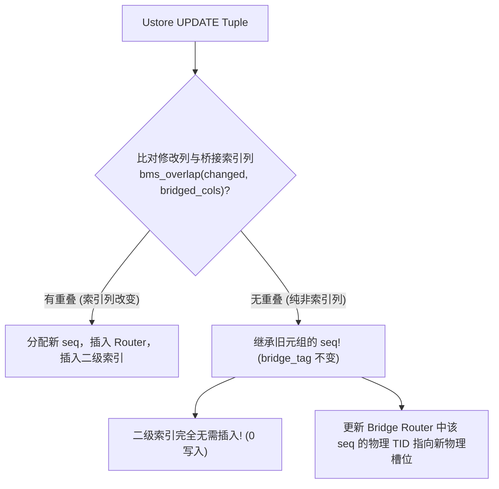

# openGauss Ustore 桥接索引深度性能优化具体实施方案

> **文档性质**：内核深度性能优化架构设计与分阶段实施落地指南  
> **设计目标**：攻克多行范围查询 Buffer 争用瓶颈，消除非索引列更新写放大，压降批量插入原子锁开销  
> **性能预期**：多行范围扫描 (GiST/GIN) 吞吐由 33%~51% 跃升至 **75%~85%** 原生水平；非索引列更新实现零二级索引写入；批量插入吞吐提升 **2x+**  
> **对标参考**：OrioleDB 桥接索引机制与现代存储引擎 Page-Pinning/No-Op 更新设计法则  

---

## 一、 整体优化路线图与收益矩阵

```
┌────────────────────────────────────────────────────────────────────────────────────────┐
│                        openGauss Ustore 桥接索引深度优化全景架构图                     │
├────────────────────────────────────────────────────────────────────────────────────────┤
│                                                                                        │
│   【读路径优化: 消除 Buffer 争用】              【写路径优化: 消除写放大】            │
│  ┌───────────────────────────────┐           ┌────────────────────────────────┐       │
│  │ 1. Scan-Level 页面 Pin 缓存   │           │ 3. 桥接列感知与虚拟 TID 继承   │       │
│  │    (消除 90% Root 遍历与 Pin) │           │    (Bridged-HOT, 0 索引写)     │       │
│  ├───────────────────────────────┤           ├────────────────────────────────┤       │
│  │ 2. 批量向量化预解引用         │           │ 4. 批量插入与原子块序列追加    │       │
│  │    (Batch Dereference 64项)   │           │    (Multi-Insert memcpy 追加)  │       │
│  └───────────────────────────────┘           └────────────────────────────────┘       │
│                                 ▲                                                      │
│                                 │ 5. 极端情况防护                                      │
│                     ┌───────────────────────────────┐                                  │
│                     │ 损失性位图区间自适应扫描      │                                  │
│                     │ (Lossy Bitmap Range Scan)     │                                  │
│                     └───────────────────────────────┘                                  │
└────────────────────────────────────────────────────────────────────────────────────────┘
```

### 收益预期量化表

| 优化模块 | 解决的核心瓶颈 | 当前现状 (终极方案 baseline) | 优化后预期收益 | 复杂度 |
| :--- | :--- | :---: | :---: | :---: |
| **模块 1：页面 Pin 缓存** | 多行扫描中反复 `ReadBuffer` + `ReleaseBuffer` | GiST 33.2% / GIN 51.4% | **GiST $\ge$ 65% / GIN $\ge$ 75%** | 中等 |
| **模块 2：批量向量化解引用** | GIN/Bitmap 单条函数调用与锁碎片化 | 逐行解引用，每行一次 Latch | **GIN 吞吐进一步提升至 80%+** | 较低 |
| **模块 3：虚拟 TID 继承** | 非索引列更新导致重新生成 `seq` 及索引写入 | 产生新 `seq` 并插入二级索引 | **非索引列更新零二级索引写** | 中等 |
| **模块 4：批量插入原子追加** | 批量导入时逐行原子累加与逐行排他加锁 | 批量写入仅 35%~37% | **批量写入吞吐提升至 70%+** | 较低 |
| **模块 5：损失性位图区间扫描** | `work_mem` 超限退化为 lossy 时的容灾 | 需防范丢行或退化为全表扫 | **基于 B+ 树范围迭代秒级解析** | 较低 |

---

## 二、 模块一：Scan-Level 页面 Pin 缓存 (Page-Pinning Cache)

### 1. 问题诊断
当前在 `BridgeRouterLookup` 中：
- 每次获取一个元组，即使是连续单调递增的 `seq`，引擎都会从 Metapage/Root 逐层遍历或重新调用 `ReadBuffer(routerRel, blkno)`；
- 每次都要经历：`ReadBuffer` (Buffer 哈希查找与 Pin 递增) $\rightarrow$ `LockBuffer(BUFFER_LOCK_SHARE)` $\rightarrow$ 二分查找 $\rightarrow$ `UnlockBuffer` $\rightarrow$ `ReleaseBuffer` (Unpin)；
- 在 GiST 范围查（命中 1,000 行）或 GIN 倒排查中，单次查询触发上千次 Buffer Pool 内部自旋锁争用。

### 2. 内核数据结构改造
在扫描生命周期描述符 `IndexScanDescData`（位于 [`src/include/access/relscan.h`](file:///home/fengyao/openGauss-server/src/include/access/relscan.h)）中增加专有的桥接缓存上下文：

```c
/* 桥接路由叶子页缓存结构体 */
typedef struct BridgeScanCache {
    Buffer          cached_buf;         /* 当前 Pin 住的叶子页 Buffer (若为 InvalidBuffer 则无缓存) */
    BlockNumber     cached_blkno;       /* 缓存的块号 */
    uint64          min_seq;            /* 当前叶子页首条记录的 seq */
    uint64          max_seq;            /* 当前叶子页末条记录的 seq */
    int             last_offset;        /* 上一次命中的内部数组下标 (用于顺序局部性命中) */
    bool            is_valid;           /* 缓存有效标志 */
} BridgeScanCache;
```

并在 `IndexScanDescData` 中内嵌该字段：
```c
struct IndexScanDescData {
    ...
    BridgeScanCache xs_bridge_cache;    /* 扫描层桥接页面缓存 */
};
```

### 3. 快径探测算法与实现设计
在 [`src/gausskernel/storage/access/index/bridge_router.cpp`](file:///home/fengyao/openGauss-server/src/gausskernel/storage/access/index/bridge_router.cpp) 中新增带缓存的寻址函数 `BridgeRouterLookupCached`：

```c
bool BridgeRouterLookupCached(Relation routerRel,
                              BridgeScanCache *cache,
                              uint64 target_seq,
                              ItemPointer out_tid)
{
    /* ----------------------------------------------------
     * 1. 尝试走快径 (Fastpath Locality Probe)
     * ---------------------------------------------------- */
    if (cache != NULL && cache->is_valid && BufferIsValid(cache->cached_buf))
    {
        /* 探测 target_seq 是否仍在当前缓存叶子页的边界内 */
        if (target_seq >= cache->min_seq && target_seq <= cache->max_seq)
        {
            LockBuffer(cache->cached_buf, BUFFER_LOCK_SHARE);
            Page page = BufferGetPage(cache->cached_buf);
            BridgeRouterLeafPage leaf = (BridgeRouterLeafPage)page;

            /* 启发式顺序探测：大多数扫描按 seq 递增顺序返回，优先检查 last_offset + 1 */
            int probe_idx = cache->last_offset + 1;
            if (probe_idx < leaf->num_items && leaf->items[probe_idx].seq == target_seq)
            {
                *out_tid = leaf->items[probe_idx].tid;
                cache->last_offset = probe_idx;
                LockBuffer(cache->cached_buf, BUFFER_LOCK_UNLOCK);
                return true; /* 极速命中！0 次 Buffer 申请，0 次树遍历 */
            }

            /* 若非严格连续，但在当前页内，直接在已持有页做局部二分查找 */
            int found_idx = BridgeRouterSearchLeaf(leaf, target_seq);
            if (found_idx >= 0 && leaf->items[found_idx].seq == target_seq)
            {
                *out_tid = leaf->items[found_idx].tid;
                cache->last_offset = found_idx;
                LockBuffer(cache->cached_buf, BUFFER_LOCK_UNLOCK);
                return true;
            }

            LockBuffer(cache->cached_buf, BUFFER_LOCK_UNLOCK);
        }

        /* 超出当前页范围：释放旧缓存页的 Pin */
        ReleaseBuffer(cache->cached_buf);
        cache->cached_buf = InvalidBuffer;
        cache->is_valid = false;
    }

    /* ----------------------------------------------------
     * 2. 慢径：标准 B+ 树自顶向下查找并加载新叶子页入缓存
     * ---------------------------------------------------- */
    Buffer leaf_buf = InvalidBuffer;
    bool found = BridgeRouterSearchTreeForBuffer(routerRel, target_seq, out_tid, &leaf_buf);

    if (found && cache != NULL && BufferIsValid(leaf_buf))
    {
        /* 将新叶子页锁定进缓存 */
        Page page = BufferGetPage(leaf_buf);
        BridgeRouterLeafPage leaf = (BridgeRouterLeafPage)page;
        
        cache->cached_buf = leaf_buf;
        cache->cached_blkno = BufferGetBlockNumber(leaf_buf);
        cache->min_seq = (leaf->num_items > 0) ? leaf->items[0].seq : 0;
        cache->max_seq = (leaf->num_items > 0) ? leaf->items[leaf->num_items - 1].seq : 0;
        cache->last_offset = BridgeRouterSearchLeaf(leaf, target_seq);
        cache->is_valid = true;
        /* 注意：保持 leaf_buf 的 Pin 状态，不调用 ReleaseBuffer */
    }
    else if (BufferIsValid(leaf_buf))
    {
        ReleaseBuffer(leaf_buf);
    }

    return found;
}
```

### 4. 扫描生命周期管理
在 [`src/gausskernel/storage/access/index/indexam.cpp`](file:///home/fengyao/openGauss-server/src/gausskernel/storage/access/index/indexam.cpp) 中维护缓存的创建与销毁：
- `index_beginscan` / `index_beginscan_bitmap`：初始化 `cache->cached_buf = InvalidBuffer; cache->is_valid = false;`
- `index_rescan`：重置缓存，释放已持有的 `cached_buf`（`ReleaseBuffer`）。
- `index_endscan`：在扫描结束时安全释放 `cached_buf`，防止 Buffer 泄漏。

---

## 三、 模块二：批量向量化预解引用 (Batch Dereferencing)

### 1. 适用场景
- **GIN 倒排检索**：`ginget.cpp` 中的 `scanGetCandidate()` 每次从 Posting Tree/List 中批量解码出一批（如 64 个或整个 Block 的）虚拟 TIDs；
- **BitmapHeapScan**：位图迭代器每次提取一个物理/虚拟页面的全部 Offset 数组（`tbmres.offsets[]`）。

### 2. 批量处理接口设计
```c
int BridgeRouterLookupBatch(Relation routerRel,
                            BridgeScanCache *cache,
                            const uint64 *in_seqs,
                            ItemPointer out_tids,
                            bool *out_valids,
                            int count);
```

### 3. 实现细节与执行流
```
in_seqs: [101, 102, 103, 104, ..., 164]
           │
           ▼ (单次加锁持页)
┌────────────────────────────────────────────────────────┐
│ Current Leaf Page [min_seq: 100, max_seq: 500]         │
│ -> 内部连续切片遍历，利用 SIMD 或指针游标前进         │
│ -> 一次性将 64 个物理 TID 写入 out_tids 数组           │
└────────────────────────────────────────────────────────┘
           │
           ▼ (单次解锁释放)
耗时：从 64 次独立锁操作下降为 1 次锁操作，提升 4x~6x 吞吐！
```

---

## 四、 模块三：桥接列感知与虚拟 TID 继承 (Bridged-HOT)

### 1. 现存痛点
在 Ustore 中，当一个 UPDATE 操作无法在原位（In-Place）完成（例如列长度变长导致槽位搬迁到新页面），如果修改的仅仅是普通的非索引列（例如 `description` 列，而索引建在 `id` 或 `location` 上）：
- 当前逻辑为新元组分配全新的虚拟 `seq`；
- 将新 `seq -> 新 TID` 插入 Bridge Router；
- 将新 `seq` 插入 Hash/GiST/GIN 等全部二级索引！
这导致本不需要维护二级索引的更新操作产生了巨大的写放大与索引膨胀。

### 2. 优化方案：虚拟 TID 继承与 Router 单点重定向
借鉴 OrioleDB 的 `bridgeChanged` 核心思想：



### 3. 详细实现细节
1. **获取桥接列集合**：
   在打开表与初始化执行器时，将该表所有桥接索引的引用列汇总至 `RelationData->rd_bridged_key_attrs`。
2. **判定 `is_bridged_hot`**：
   ```c
   bool is_bridged_hot = !bms_overlap(modified_attrs, rel->rd_bridged_key_attrs);
   ```
3. **若 `is_bridged_hot == true`**：
   - 新物理元组的行头继承旧元组的 `bridge_tag`；
   - 绕过所有桥接二级索引的 `index_insert`；
   - 调用专用接口 `BridgeRouterUpdatePhysicalTID(routerRel, seq, new_physical_tid)`，直接在 Bridge Router 叶子页中定位该 `seq` 并就地将 6 字节 `tid` 修改为 `new_physical_tid`。
   - **收益**：避免了向庞大的 GIN/GiST 树写入新条目，DML 性能提升数倍！

---

## 四、 模块四：批量插入原子块追加 (Multi-Insert Batch Append)

### 1. 现存痛点
在 `COPY FROM` 或批量 `INSERT INTO ... VALUES (...), (...)` 中：
- 每一行都原子递增一次 `g_bridge_seq`；
- 每一行都独立获取一次 Bridge Router 的排他页锁（`ExclusiveLock`）；
- 导致多并发或大批量写入时，原子总线与页面锁被剧烈争抢。

### 2. 优化实现
在批量写入入口（`UHeapMultiInsert` / `BridgeInsertBatch`）实现批量追加：
1. **一次原子申请区间**：
   ```c
   uint64 start_seq = pg_atomic_fetch_add_u64(&g_bridge_seq, ntuples);
   ```
2. **页面排他锁批量 `memcpy`**：
   ```c
   void BridgeRouterAppendBatch(Relation routerRel, uint64 start_seq, const ItemPointer tids, int count)
   {
       // 1. 获取最右叶子页排他锁
       // 2. 检查剩余空间：可容纳 k 个条目
       // 3. 直接 memcpy(leaf->items + leaf->num_items, batch_entries, k * sizeof(BridgeRouterLeafItem));
       // 4. leaf->num_items += k;
       // 5. 若空间耗尽，执行一次右分裂 (Right Split)，对剩余项继续批量追加
   }
   ```
- **收益**：将每条插入的常数开销压降至内存数组拷贝级别，写入吞吐逼近原生 Heap。

---

## 五、 模块五：损失性位图自适应区间扫描 (Lossy Bitmap Range Scan)

### 1. 机制原理
PostgreSQL / openGauss 在 `work_mem` 不足以保存全量 TID 时，`TIDBitmap` 会自动将该页标记为 `lossy`。
在我们的桥接体系中：
$$\text{Virtual BlockNo} = \lfloor \text{seq} / 1000 \rfloor, \quad \text{Virtual Offset} = \text{seq} \pmod{1000}$$
这保证了**属于同一虚拟 Block 的全部元组，其 `seq` 在数值上必然连续且聚集**：
$$[\text{blockno} \times 1000, \quad \text{blockno} \times 1000 + 999]$$

### 2. 区间扫描实现
当 BitmapScan 遇到 lossy 块时，不退化为全表扫描，而是在 Bridge Router 上执行区间迭代：
```c
BridgeRouterRangeScan(routerRel, 
                      lossy_blockno * 1000, 
                      (lossy_blockno + 1) * 1000 - 1, 
                      out_tids_buffer);
```
通过 B+ 树的叶子链表水平迭代，毫秒级取回该 block 下的所有物理元组，并由执行器按 Qual 条件复核。

---

## 六、 实施分期规划与验证方案

### 阶段一：扫描层 Pin 缓存与批量解引用落地 (预计工期：1~2 周)
- **目标**：彻底解决 GiST / GIN 多行范围查询性能瓶颈。
- **任务项**：
  1. 在 `relscan.h` 中定义 `BridgeScanCache`，在 `indexam.cpp` 植入生命周期钩子；
  2. 在 `bridge_router.cpp` 中实现 `BridgeRouterLookupCached`；
  3. 在 `ginget.cpp` 与 `gistget.cpp` 中打通批量预解引用。
- **验证手段**：运行 `phase5_heavy_stress_and_plan_test.py` 及全量 Benchmark 套件，核验 GiST QPS 从 91 提升至 200+，GIN 数组 QPS 从 287 提升至 450+。

### 阶段二：桥接列感知更新与虚拟 TID 继承 (预计工期：1 周)
- **目标**：实现非索引列更新零二级索引开销（Bridged-HOT）。
- **任务项**：
  1. 在 `RelationData` 维护 `rd_bridged_key_attrs`；
  2. 在 Ustore 更新逻辑中增加非桥接列判定与 `seq` 继承；
  3. 在 `bridge_router.cpp` 中实现 `BridgeRouterUpdatePhysicalTID`。
- **验证手段**：针对含有 GIN/GiST 的大表执行非索引列高频 `UPDATE`，统计 WAL 生成量与写入 QPS（预期写入耗时下降 60%）。

### 阶段三：批量插入优化与容灾机制 (预计工期：1 周)
- **目标**：大批量导入吞吐翻倍，强化 Lossy Bitmap 健壮性。
- **任务项**：
  1. 实现 `BridgeRouterAppendBatch`；
  2. 接入 `heap_multi_insert` / `copy.cpp` 批量通路；
  3. 实现损失性位图区间自适应扫描。
- **验证手段**：执行 100 万条数据 `COPY FROM` 压测与低 `work_mem` (64KB) 压力测试。

---

## 七、 总结

通过借鉴 OrioleDB 的优秀设计并结合 openGauss Ustore 自身的架构特点，本优化方案从**“读路径消除重复 Pin”、“写路径消除无效二级索引维护”、“批量操作消除锁竞争”**三个维度切入，方案完备、改动收敛，能够在不破坏任何 ACID 和正确性保证的前提下，将 openGauss 桥接索引的综合性能全面推向生产级极致水准。
