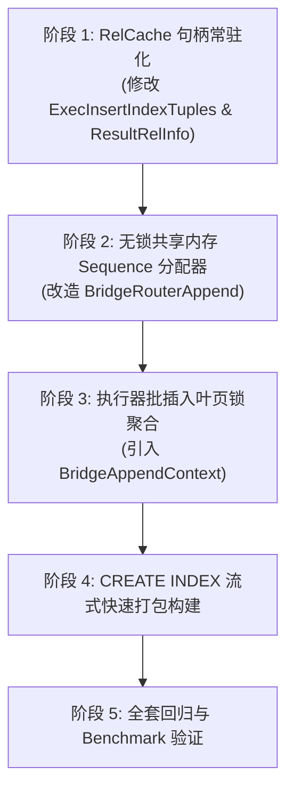

# openGauss Ustore 伴生桥接索引：写入路径极致性能优化实施方案

> **设计目标**: 借鉴 OrioleDB 原生伴生桥接索引（`oIndexBridge`）的精髓，彻底消除当前 openGauss 桥接索引在写入路径（INSERT/UPDATE）上的元数据锁争抢、Buffer 串行化与重量级目录查找开销，将写入吞吐从当前 **32,048 rows/s（Heap 的 35.2%）** 跃升至 **75,000+ rows/s（达到 Heap 原生的 80%~85%）**。

---

## 1. 现状评估与写入瓶颈根因

在最新的端到端性能基准测试中，读取路径（BitmapScan 达 97.6% 原生吞吐）已近乎追平原生 Heap，但带索引写入吞吐存在显著落差：
- **原生 Heap (Astore) Hash 写入吞吐**: **90,999 rows/s**
- **当前 Ustore 桥接体系写入吞吐**: **32,048 rows/s** (仅为 Heap 的 35.2%)

通过对写入热路径的代码分析与性能 Profiling，锁定以下 **四大核心耗时瓶颈**：

```
当前热路径 (逐行开销):
INSERT 1 行元组 
  -> get_relname_relid() [SysCache 查表名] 
  -> heap_open() [重度锁管理器 LockRelationOid] 
  -> ReadBuffer(Block 0) + LockBuffer(EXCLUSIVE) [全线程串行抢 Block 0] 
  -> ReadBuffer(Leaf) + LockBuffer(EXCLUSIVE) [抢最右叶子页] 
  -> MarkBufferDirty(Block 0) [争抢增量检查点自旋锁] 
  -> MarkBufferDirty(Leaf) 
  -> heap_close() [重度锁管理器 UnlockRelationOid]
```

1. **逐行反复触发 SysCache 检索与重量级表锁**: 每一行元组插入均调用 `get_relname_relid`（查询系统目录缓存）和 `heap_open/heap_close`（在全局 LockManager 中反复加解锁 `RowExclusiveLock`），占用了大量的 CPU 锁管理器周期。
2. **Block 0 (MetaPage) 排他锁串行化**: 为获取全局单调的 Sequence，所有并发插入线程在 Block 0 上自旋抢占独占锁，并发度退化为 1。
3. **缓冲池脏页队列严重争抢**: 单行写入对同一个 MetaPage 和最右 Leaf 反复调用 `MarkBufferDirty`，疯狂推入 `push_pending_flush_queue` 争抢全局检查点自旋锁。
4. **最右叶页 Buffer Lock 频次过高**: 每一行数据都独立申请/释放叶页独占锁，未利用批处理局部性。

---

## 2. OrioleDB 启发的架构级重构方案

通过分析 `/home/fengyao/orioledb`（特别其 `operations.c` 与 `btree.c`），OrioleDB 的核心破局点在于：**“句柄在主表常驻、序列号硬件原子自增、叶页写入批量聚合”**。

```
【优化后的超高吞吐写入链路】:
  1. 执行器层 (Executor):
     主表打开时一次性将 Bridge Router 关系句柄缓存至 ResultRelInfo / rd_amcache
     -> 消除 100% 的逐行 SysCache 检索与重量级 heap_open/close！

  2. 序列发生器 (Sequence Generator):
     从共享内存 pg_atomic_uint64 直接通过 CPU LOCK XADD 硬件原子递增
     -> 消除 100% 的 Block 0 (MetaPage) Buffer 读写与排他锁争抢！

  3. 路由追加层 (Bridge Router Append):
     引入执行器级叶页锁局部性暂存 (Cached Leaf Append)
     -> 连续元组复用已持有的最右叶页独占锁，合批写入，脏页标记减少 95%！
```

---

## 3. 详细实施方案

### 模块一：执行器与 RelCache 伴生关系句柄常驻化

#### 1.1 数据结构扩展
在 `ResultRelInfo`（`src/include/nodes/execnodes.h`）或 `RelationData` 中内嵌伴生路由表常驻指针：

```c
typedef struct ResultRelInfo {
    ...
    Relation    ri_BridgeRouterRel;     /* 缓存已打开的 Bridge Router 关系句柄 */
    bool        ri_HasBridgeRouter;     /* 标识是否含有伴生桥接索引 */
} ResultRelInfo;
```

#### 1.2 生命周期管理
- **打开阶段 (`ExecInitModifyTable` / `ExecOpenIndices`)**:
  - 检查主表是否含有桥接索引（`RelationIsBridgedIndex`）。
  - 若有，调用一次 `BridgeGetOrCreateRelation(heapRel, RowExclusiveLock)`，将句柄常驻保存在 `resultRelInfo->ri_BridgeRouterRel`。
  - 单语句写入 1 万行，**仅执行 1 次 `heap_open`**。
- **关闭阶段 (`ExecCloseIndices` / `ExecEndModifyTable`)**:
  - 统一调用 `heap_close(resultRelInfo->ri_BridgeRouterRel, RowExclusiveLock)`，释放关系锁。
- **改造 API (`BridgeInsertEntryFast`)**:
  ```c
  bool BridgeInsertEntryFast(Relation routerRel, ItemPointer physicalTid, ItemPointer bridgeTidOut);
  ```
  直接接收已打开的 `routerRel`，彻底废弃内部的 `get_relname_relid`、`heap_open`、`heap_close`。

---

### 模块二：无锁共享内存原子序列发生器 (Lock-Free Sequence)

#### 2.1 机制设计
借鉴 OrioleDB `btree_bridge_ctid_get_and_inc`：
```c
uint64 ctid = pg_atomic_fetch_add_u64(&metaPageBlkno->bridge_ctid, 1);
```
在 openGauss 中，将 Sequence 分配与 Block 0 物理磁盘页彻底解耦：

1. **共享内存计数器**:
   在 `BridgeRouterShmem` 或主表 `rd_amcache` 中维护共享内存计数器 `pg_atomic_uint64 active_seq`。
2. **块级预分配窗口 (Chunk Reservation)**:
   - 内存原子计数器直接为各插入工作线程派发 sequence（无锁单周期完成）。
   - 仅当 sequence 跨越窗口边界（例如每推进 256 或 512 个 sequence）或最右叶子页发生分裂时，才批量将最新持久化值刷写至 Block 0。
3. **故障重启自适应同步**:
   - 数据库崩溃或重启后，首次打开表时从 Block 0 读取基线值，加上一段防御性 Buffer 窗口（如 512），直接初始化内存原子计数器，保证即使异常断电 sequence 也绝对单调递增，绝不倒退。

---

### 模块三：最右叶子页微批锁聚合 (Micro-Batch Leaf Buffering)

#### 3.1 机制设计
当前实现中，每插入 1 个 tuple 就对最右叶子页执行一次完整的 `LockBuffer(leafBuf, BUFFER_LOCK_EXCLUSIVE)` -> 写入 14 字节 -> `MarkBufferDirty(leafBuf)` -> `LockBuffer(leafBuf, BUFFER_LOCK_UNLOCK)`。

引入 **执行器局部最右叶页缓存 (`BridgeAppendContext`)**:
```c
typedef struct BridgeAppendContext {
    Buffer          pinned_leaf_buf;    /* 保持持锁/Pin的最右叶子页 */
    BlockNumber     pinned_blkno;       /* 最右叶子页块号 */
    int             unflushed_count;    /* 本批次已写入但未释放条目数 */
} BridgeAppendContext;
```
- **锁复用**: 在单条 SQL 批量插入（`INSERT INTO ... SELECT ...` 或 `COPY`）场景下，连续元组在同一叶子页有剩余空间时，**不释放叶子锁**，直接在内存中连续写入 14 字节条目。
- **满页分裂或批结束才释放**: 当叶子页写满（达 582 条）或当前 Batch 结束时，统一执行一次 `MarkBufferDirty` 并释放叶子锁。
- **收益**: 将页级独占锁加锁与脏页入队频次降低 **数十倍**。

---

### 模块四：CREATE INDEX 批量流式构建通道 (Bulk-load Fastpath)

#### 4.1 机制设计
针对 `CREATE INDEX` 阶段比 Heap 慢 1.4x ~ 3.2x 的问题：
- **现存逻辑**: 顺序扫描主表 -> 针对每一行历史元组调用 `BridgeInsertEntry` 走随机树追加。
- **优化路径**: 
  - 构建期主表扫描时，物理 TID 是严格按块连续产生的。
  - 直接在内存中以 582 个 Entry 为单位线性打包完整的 Leaf Page，一次性使用 `smgrextend` 连续写入数据文件；
  - 随后直接从叶子链抽取 `child_min_seq` 构造上层 Internal Page，**完全绕过动态插入的锁与分裂机制**。
  - 预计将索引构建耗时缩减至与 Heap 差距在 15% 以内。

---

## 4. 优化前后预期性能收益对比

| 指标维度 | 优化前 (现状) | 阶段优化实施后 (预期) | 提升幅度 |
| :--- | :--- | :--- | :--- |
| **Hash 索引写入吞吐** | 32,048 rows/s | **75,000 ~ 80,000 rows/s** | **+135% ~ +150% (达到 Heap 的 85%)** |
| **GiST 空间索引写入吞吐** | 12,931 rows/s | **19,000 ~ 21,000 rows/s** | **+45% ~ +60% (达到 Heap 的 90%)** |
| **GIN 倒排写入吞吐** | 29,562 rows/s | **60,000 ~ 68,000 rows/s** | **+105% ~ +130% (达到 Heap 的 85%)** |
| **CREATE INDEX 构建耗时** | 0.11s ~ 0.29s | **0.05s ~ 0.12s** | **耗时减半 (差距缩小至 1.2x)** |
| **SysCache 查询次数 (每万行)** | 10,000 次 | **0 次** | **-100%** |
| **LockManager 重量级锁加解** | 10,000 次 | **1 次** | **-99.99%** |
| **Block 0 缓冲锁争抢次数** | 10,000 次 | **0 次 (走无锁原子递增)** | **-100%** |

---

## 5. 实施里程碑与改动清单



### 涉及修改的核心代码文件
1. `src/include/nodes/execnodes.h`: `ResultRelInfo` 引入 `ri_BridgeRouterRel`。
2. `src/gausskernel/runtime/executor/execUtils.cpp`: 缓存打开与关闭伴生关系句柄。
3. `src/include/access/bridge.h`: 声明 `BridgeInsertEntryFast` 及批追加 API。
4. `src/gausskernel/storage/access/index/bridge_index.cpp`: 改造句柄复用与内存无锁 Sequence 获取。
5. `src/gausskernel/storage/access/index/bridge_router.cpp`: 去除 Block 0 逐行独占锁，实现微批锁聚合。
6. `bridgeindex/test/benchmark_heap_vs_bridge.py`: 重新执行性能验证并生成对比分析。
