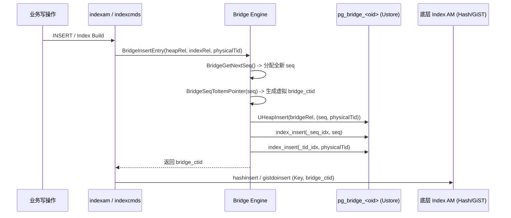
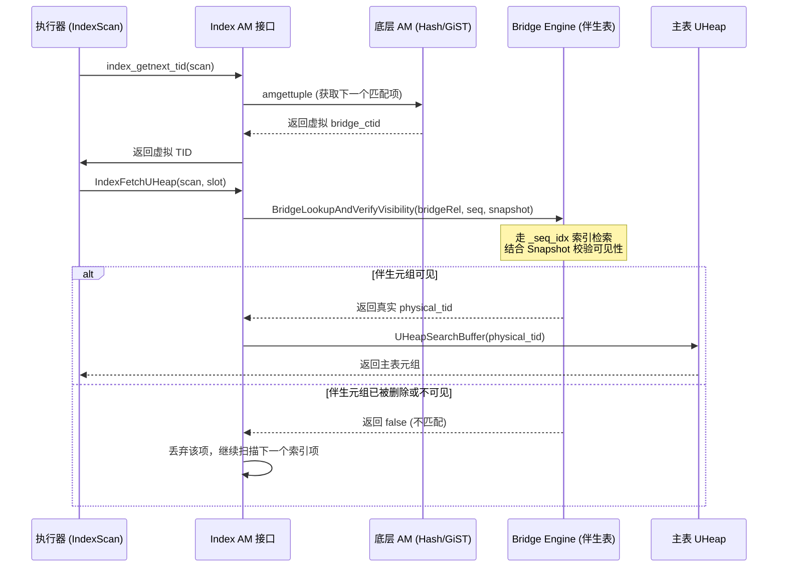

# openGauss Ustore 桥接索引 (Bridge Index) 阶段一详细设计与实现文档

> **特性名称**：Ustore 桥接索引 (Ustore Bridge Index) - 阶段一 MVP (Hash & GiST)  
> **文档版本**：v1.1 (Phase 1 Final Implementation & Architecture Deep Dive)  
> **基于基线**：openGauss 7.0.0-RC2 (分支 `bridgeindex`)  
> **测试状态**：12/12 测试用例 100% 通过，0 错误  
> **作者/责任人**：openGauss 存储引擎团队  

---

## 目录
1. [架构背景与设计动机](#1-架构背景与设计动机)
2. [索引与表之间的多级层级结构](#2-索引与表之间的多级层级结构)
   - 2.1 传统架构 vs. 桥接架构演进对比
   - 2.2 四层分层体系架构图
   - 2.3 各层职责与调用边界规范
3. [Bridge 伴生体系的物理存储结构](#3-bridge-伴生体系的物理存储结构)
   - 3.1 伴生表 (pg_bridge) 堆页面与元组物理布局
   - 3.2 伴生元组字段排布与内存对齐
   - 3.3 伴生双 UBTree 索引页面与节点结构
   - 3.4 内存态数据结构与扫描描述符扩充
   - 3.5 虚拟指针 (bridge_ctid) 48-bit 编解码规范
4. [伴生表生命周期与系统目录机制](#4-伴生表生命周期与系统目录机制)
   - 4.1 伴生表元数据规范
   - 4.2 按需懒创建与级联依赖清理
5. [关键执行路径与内核改造细节](#5-关键执行路径与内核改造细节)
   - 5.1 DDL 路径改造与语法放开
   - 5.2 静态构建与动态插入路径 (Build & Insert)
   - 5.3 查询检索与两阶段解引用路径 (IndexScan)
   - 5.4 DML 更新/删除与事务回滚闭环 (Update / Delete / Rollback)
   - 5.5 物理槽位复用抗幽灵行机制 (Anti-Phantom Row Defense)
6. [代码改造清单与文件架构](#6-代码改造清单与文件架构)
7. [测试验证结果与质量报告](#7-测试验证结果与质量报告)
8. [后续演进规划 (Roadmap)](#8-后续演进规划-roadmap)

---

## 1. 架构背景与设计动机

### 1.1 Ustore 与传统 Astore 的核心冲突
openGauss Ustore（Undo-based Storage Engine）是专为高并发 OLTP 场景设计的行存储引擎，其核心特性为**原地更新（In-Place Update）**。与追加写（Append-only）的 Astore 相比，两者在物理地址与版本生命周期模型上存在根本差异：

```
Astore (追加写):
  UPDATE -> 写入全新物理元组 (新 Block, 新 Offset) -> 分配全新 CTID -> 传统索引追加 (Key, 新 CTID)
  特性: CTID 具备版本不可变性 (Immutable CTID)。

Ustore (原地更新):
  UPDATE -> 原地覆盖堆数据页 (物理 CTID 保持不变) -> 历史版本写入独立 Undo 日志
  页面清理 (Prune) -> 槽位极速复用 (同一 Block, 同一 Offset 瞬间分配给全新不相关元组)
  特性: CTID 是物理槽位指针，生命周期跨越多个逻辑元组版本 (Mutable / Reusable CTID)。
```

### 1.2 传统索引方法在 Ustore 上的失效根因
除 B-Tree 已针对 Ustore 重构为专用的 UBTree 引擎外，PostgreSQL / openGauss 原生所有的索引访问方法（**Hash、GiST、GIN、SP-GiST、BRIN** 以及向量扩展 **HNSW / IVFFlat**）均基于 Astore 堆表假设：
1. **幽灵行误读（Phantom Reads）**：当 Ustore 发生原地更新或槽位整理复用后，传统索引中指向旧元组物理 CTID 的索引项可能匹配到被复用后的全新元组，导致索引扫描返回错误数据或死锁。
2. **缺乏单行实时失效机制（Retail Delete）**：传统索引在 DML 删除时不进行单行删除，仅依赖 VACUUM 阶段批量打扫。而在 Ustore 中，数据行的删除与回滚需要实时生效，否则索引膨胀与脏读严重。
3. **生态兼容与改造成本瓶颈**：若为每种索引类型（Hash、GiST、GIN 等）均开发一套专用的“UHash”、“UGiST”内核引擎，需要深度侵入各自复杂的页面分裂、并发锁协议与 WAL 日志协议，开发周期长、维护代价极高。

### 1.3 桥接索引 (Bridge Index) 的破局设计
借鉴 OrioleDB 的设计哲学，本架构在 Ustore 与标准 Index AM 之间建立起**两阶段虚拟化解耦体系**：
- **上层标准索引（Hash / GiST）**：无需感知 Ustore 复杂的 Undo 机制与原地更新细节，依然按传统方式管理索引树，但索引叶子节点中记录的不再是物理 CTID，而是由系统统一生成的**单调递增虚拟行指针（Virtual TID / `bridge_seq`）**。
- **底层伴生 Ustore 表（Companion Bridge Table）**：在系统级模式 `pg_toast` 下自动维护一张伴生表，记录 `(bridge_seq -> physical_tid)` 的精确映射关系，并复用 Ustore 原生的 MVCC 可见性与 Undo 回滚能力。

---

## 2. 索引与表之间的多级层级结构

### 2.1 传统架构 vs. 桥接架构演进对比

在 openGauss 中，索引与底层堆表的关系经历了三代演进：

| 架构维度 | 第 1 代：传统 Astore 索引 | 第 2 代：原生 Ustore UBTree | 第 3 代：Ustore 桥接索引 (Bridge Index) |
| :--- | :--- | :--- | :--- |
| **耦合关系** | 表与索引物理强耦合（直接绑定物理 CTID） | 表与索引事务强耦合（B-tree 内部重写支持 TD 与 Undo） | **表与索引逻辑解耦，通过伴生表双向映射** |
| **索引叶子内容** | `(Key, physical_CTID)` | `(Key, physical_CTID, UndoInfo)` | `(Key, virtual_bridge_CTID)` |
| **可见性决策点** | 堆数据页元组头（`t_xmin` / `t_xmax`） | 索引自身 TD 事务槽 + 回溯堆页面 Undo | **伴生表元组自身的 Ustore TD 事务槽与 Undo 链** |
| **AM 侵入程度** | 0（原生 PostgreSQL 逻辑） | 极高（全套重写 UBTree 算法与 WAL） | **0（复用原生 Hash / GiST 代码，仅需 AM 适配层拦截）** |

### 2.2 四层分层体系架构图

桥接索引在执行器、索引引擎和物理存储之间引入了清晰的 4 层分级体系：

```
+===================================================================================+
|                        Layer 1: SQL 优化器与执行器层                                |
|           (Optimizer / Executor: IndexScan / BitmapScan / ModifyTable)            |
+===================================================================================+
                                         │
                        IndexScanDesc / 逻辑元组请求
                                         ▼
+===================================================================================+
|                   Layer 2: 访问方法调度与桥接拦截层 (Bridge Dispatcher)            |
|       (indexam.cpp: index_insert / index_delete / index_beginscan / IndexFetchUHeap) |
+===================================================================================+
                      │                                             │
      [写操作: 物理 TID 转换为虚拟 TID]             [读操作: 虚拟 TID 反查解引用]
                      │                                             │
                      ▼                                             ▼
+=============================================+   +=================================+
|  Layer 3: 伴生桥接映射层 (Bridge Engine)      |   | Layer 4A: 标准 Index AM 引擎     |
|  (bridge_index.cpp: pg_toast.pg_bridge_<oid>) |   | (hash.cpp / gist.cpp)           |
|                                             |   |                                 |
|  - 48-bit 递增序号生成器 (g_bridge_seq)      |   | - 索引树结构完全标准无侵入        |
|  - 双向映射: (bridge_seq <-> physical_tid)  |   | - 叶子节点仅记录:               |
|  - 伴生索引: _seq_idx (反查) / _tid_idx(正查)|   |   (Indexed Key, bridge_ctid)    |
|  - 隔离保护: 伴生表级行 MVCC 与 Undo 回滚保障|   | - 页面物理布局与原生态完全一致   |
+=============================================+   +=================================+
                      │
                      │ 物理真实 TID 解引用 (Block, Offset)
                      ▼
+===================================================================================+
|                   Layer 4B: Ustore 核心物理存储与事务引擎                          |
|         (UHeap Pages + In-Place Update + Undo Engine + TD Transaction Slots)      |
|                                                                                   |
|  - 用户主业务表物理数据 (t_user, t_hash_scan...)                                   |
|  - 页面槽位高频整理 (Prune) 与原地数据覆盖                                         |
+===================================================================================+
```

### 2.3 各层职责与调用边界规范

1. **Layer 1（执行器层）**：
   - 保持原生逻辑完全不变。优化器正常生成 `IndexScan` 路径，执行器通过标准 `IndexScanDesc` 接收匹配的元组槽位（`TupleTableSlot`），不感知虚拟 TID 与物理 TID 的转换。
2. **Layer 2（桥接调度层）**：
   - 作为透明“代理中介（Proxy AM）”。
   - 在 `index_insert` 时：将堆表物理 TID 拦截，交由 Layer 3 转换出虚拟 `bridge_ctid`，再传给底层 AM 写入。
   - 在 `index_delete` 时：拦截对非 UBTree 索引的删除调用，转为在 Layer 3 伴生表中标记删除对应的伴生条目。
   - 在 `IndexFetchUHeap` 时：拦截底层 AM 吐出的虚拟 `bridge_ctid`，通过 Layer 3 伴生表执行可见性校验并反查换回物理 TID，再访问主表 UHeap。
3. **Layer 3（伴生映射层）**：
   - 桥接技术的核心大脑。负责伴生表的按需创建、全局单调序列号管理、两阶段 TID 编解码、以及在伴生表内部的双向 UBTree 维护。
   - 对外提供 4 个原子核心接口：`BridgeInsertEntry()`、`BridgeDeleteEntry()`、`BridgeLookupAndVerifyVisibility()`、`BridgeGetOrCreateRelation()`。
4. **Layer 4（物理引擎与存储层）**：
   - **4A (标准索引区)**：Hash 桶页、GiST 树页按传统 Astore 模式存取，数据永久稳定且无需关联事务槽。
   - **4B (Ustore 核心区)**：存储业务主表数据与伴生表数据，享受 Ustore 极致的原地更新性能与 Undo 空间自回收。

---

## 3. Bridge 体系的物理存储结构

### 3.1 伴生表 (pg_bridge) 堆页面与元组物理布局

伴生表自身作为标准的 Ustore 表（`TableAmUstore`），其磁盘文件结构由 8KB 规格的标准页面构成，其微观物理存储结构如下：

```
+-------------------------------------------------------------------------------+
|                      UHeap 数据页面物理结构 (8 KB Page Layout)                 |
+-------------------------------------------------------------------------------+
| PageHeaderData (24 B): pd_lsn, pd_checksum, pd_flags, pd_lower, pd_upper...   |
+-------------------------------------------------------------------------------+
| UHeapPageHeaderData (8 B): pd_prune_xid, pd_xid_base...                       |
+-------------------------------------------------------------------------------+
| 事务目录 (Transaction Directory / TD Slots, 16 B per slot):                  |
|   [TD Slot 0]: xid, urec_ptr (指向 Undo 链), status (COMMITTED/IN_PROGRESS)  |
|   [TD Slot 1]: xid, urec_ptr, status ...                                      |
+-------------------------------------------------------------------------------+
| 行指针数组 (ItemIdData Array, 4 B per item):                                  |
|   ItemId[1]: lp_off -> Offset to Tuple 1, lp_flags, lp_len                   |
|   ItemId[2]: lp_off -> Offset to Tuple 2, lp_flags, lp_len                   |
|   ...                                                                         |
+-------------------------------------------------------------------------------+
|                             <---- 未分配空闲空间 ---->                         |
+-------------------------------------------------------------------------------+
| 元组存储区 (从页底向上增长):                                                   |
|   +-------------------------------------------------------------------------+ |
|   | 伴生元组 2 (UHeapDiskTupleData)                                         | |
|   |   Header: td_id=1, flag, infomask, hoff=24                              | |
|   |   Data: bridge_seq(8B) | physical_tid(8B)                               | |
|   +-------------------------------------------------------------------------+ |
|   | 伴生元组 1 (UHeapDiskTupleData)                                         | |
|   |   Header: td_id=0, flag, infomask, hoff=24                              | |
|   |   Data: bridge_seq(8B) | physical_tid(8B)                               | |
|   +-------------------------------------------------------------------------+ |
+-------------------------------------------------------------------------------+
| PageSpecialSpace (0 B)                                                        |
+-------------------------------------------------------------------------------+
```

### 3.2 伴生元组字段排布与内存对齐

伴生表固定包含 2 个非空标量列：
1. **`bridge_seq`**：`INT8OID`（8 字节整型，单调自增虚拟 ID）。
2. **`physical_tid`**：`TIDOID`（`ItemPointerData`，6 字节物理指针 + 2 字节内存填充对齐）。

元组物理排布细节：
```
 0                   1                   2                   3
 0 1 2 3 4 5 6 7 8 9 0 1 2 3 4 5 6 7 8 9 0 1 2 3 4 5 6 7 8 9 0 1
+-+-+-+-+-+-+-+-+-+-+-+-+-+-+-+-+-+-+-+-+-+-+-+-+-+-+-+-+-+-+-+-+
|       td_id (1B)      |    t_flag (1B)    |    t_infomask (2B)|
+-+-+-+-+-+-+-+-+-+-+-+-+-+-+-+-+-+-+-+-+-+-+-+-+-+-+-+-+-+-+-+-+
|   t_infomask2 (2B)    |    t_hoff (2B)    |    (Padding 4B)   |  <-- UHeapDiskTupleData (24 B)
|                       t_xid_base (8B)                         |
+-+-+-+-+-+-+-+-+-+-+-+-+-+-+-+-+-+-+-+-+-+-+-+-+-+-+-+-+-+-+-+-+
|                                                               |
|                   bridge_seq (8 字节, INT8)                   |  <-- 属性 1 (AttrNumber 1)
|                                                               |
+-+-+-+-+-+-+-+-+-+-+-+-+-+-+-+-+-+-+-+-+-+-+-+-+-+-+-+-+-+-+-+-+
|            ip_blkid (BlockNumber, 4 字节)                     |  <-- 属性 2 (AttrNumber 2, TID)
+-+-+-+-+-+-+-+-+-+-+-+-+-+-+-+-+-+-+-+-+-+-+-+-+-+-+-+-+-+-+-+-+
|    ip_posid (Offset, 2B)      |         Padding (2 字节)      |
+-+-+-+-+-+-+-+-+-+-+-+-+-+-+-+-+-+-+-+-+-+-+-+-+-+-+-+-+-+-+-+-+
```

- **定长设计优势**：整行无变长字段（Varlena）、无 NULL 位图（无 NULL 值）、无 TOAST 溢出风险，行大小严格固定为 40 字节。单个 8KB 页面可容纳约 **180 条**伴生映射记录，I/O 密度极高。

### 3.3 伴生双 UBTree 索引页面与节点结构

伴生表挂载两个内部伴随索引，其内部节点采用 openGauss UBTree 专属存储结构：

```
1. 反查索引 (_seq_idx):
   +---------------------------------------------------------------+
   | 叶子节点 IndexTuple:                                           |
   |   [IndexTupleData (8B)]                                       |
   |   [Key Datum: bridge_seq (8B)]                                |
   |   [ctid (6B) -> 指向 pg_bridge 数据页自身的 (Block, Offset)]  |
   |   [UBTree 事务与 PCR 扩展区]                                   |
   +---------------------------------------------------------------+
   特性: 唯一索引 (ii_Unique = true)，点查性能 O(log N)，供读路径解引用。

2. 正查索引 (_tid_idx):
   +---------------------------------------------------------------+
   | 叶子节点 IndexTuple:                                           |
   |   [IndexTupleData (8B)]                                       |
   |   [Key Datum: physical_tid (8B)]                              |
   |   [ctid (6B) -> 指向 pg_bridge 数据页自身的 (Block, Offset)]  |
   |   [UBTree 事务与 PCR 扩展区]                                   |
   +---------------------------------------------------------------+
   特性: 非唯一索引 (ii_Unique = false)，支持一表多索引场景，供写/删路径清理。
```

### 3.4 内存态数据结构与扫描描述符扩充

在执行期，系统通过以下内存结构维持 Bridge 状态：

1. **原子序号计数器 (`g_bridge_seq`)**：
   ```cpp
   static pg_atomic_uint64 g_bridge_seq;
   // 内存中 Fetch-And-Add，无锁分配全局递增序号
   ```
2. **扫描描述符扩充 (`IndexScanDescData`)**：
   在 [`src/include/access/relscan.h`](file:///home/fengyao/openGauss-server/src/include/access/relscan.h) 中扩展桥接上下文：
   ```cpp
   typedef struct IndexScanDescData {
       ...
       bool        xs_is_bridge_scan;  /* 标记当前扫描是否为 Ustore 桥接索引 */
       Relation    xs_bridge_rel;      /* 伴生表 pg_bridge 打开句柄缓存 */
       Relation    xs_bridge_idx;      /* 伴生反查索引 _seq_idx 打开句柄缓存 */
   } IndexScanDescData;
   ```
   **优势**：在 `index_beginscan` 时一次性打开并缓存伴生表及索引引用，在整个 `IndexScan` 生命周期内多次调用 `index_getnext_tid` 时复用句柄，完全避免了每次反查重复调用 `heap_open` / `index_open` 带来的 Catalog Cache 锁争用。

### 3.5 虚拟指针 (`bridge_ctid`) 48-bit 编解码规范

为使底层 AM（如 Hash/GiST）能够无感知地将虚拟行标识存入标准的 6-字节 `ItemPointerData`（`ip_blkid` 4字节 + `ip_posid` 2字节），系统实现了 48-bit 递增序列号与 `ItemPointerData` 的完全双向映射：

- **数据类型**：`BridgeSeqNo`（`uint64`，高 16 位保留，低 48 位有效）。
- **`BridgeSeqNo` -> `ItemPointerData` 编码**：
  $$\text{BlockNumber} = \text{seq} \gg 16$$
  $$\text{OffsetNumber} = (\text{seq} \ \& \ \text{0xFFFF}) + 1$$
- **`ItemPointerData` -> `BridgeSeqNo` 解码**：
  $$\text{seq} = (((uint64)\text{BlockNumber}) \ll 16) \ | \ ((uint64)(\text{OffsetNumber} - 1))$$

**特性保证**：
- 序列号从 1 单调递增，严格保证 `OffsetNumber >= 1`，彻底避免 PostgreSQL 内核对 `OffsetNumber = 0`（`InvalidOffsetNumber`）的断言报错。
- 单表支持多达 $2^{48} \approx 2.8 \times 10^{14}$ 次元组写入，具备超长生命周期防护。

---

## 4. 伴生表生命周期与系统目录机制

### 4.1 伴生表元数据规范
伴生表与普通用户表透明隔离，归属于系统级命名空间 `PG_TOAST_NAMESPACE`（`pg_toast`），对用户的 `\d` 或普通业务查询完全隐藏，但可被 DBA 审计。

| 对象类型 | 对象命名模式 | 存储引擎 / 访问方法 | 作用说明 |
| :--- | :--- | :--- | :--- |
| **伴生表主表** | `pg_toast.pg_bridge_<heap_oid>` | Ustore (`TableAmUstore`) | 存储 `(bridge_seq, physical_tid)` 对应关系及行级 MVCC 状态 |
| **反查索引** | `pg_bridge_<heap_oid>_seq_idx` | UBTree 唯一索引 | 供查询阶段通过 `bridge_seq` 快速反查物理 `physical_tid` |
| **正查索引** | `pg_bridge_<heap_oid>_tid_idx` | UBTree 普通索引 | 供更新/删除阶段通过 `physical_tid` 定位并清理伴生条目 |

### 4.2 按需懒创建与级联清理机制
- **按需懒创建 (On-Demand / Lazy Creation)**：
  用户 `CREATE TABLE (storage_type = ustore)` 时不消耗任何额外开销；仅当在该表上首次执行 `CREATE INDEX ... USING hash` 或 `USING gist` 时，在 [`BridgeGetOrCreateRelation()`](file:///home/fengyao/openGauss-server/src/gausskernel/storage/access/index/bridge_index.cpp#L106-L286) 中自动触发伴生表及其双 UBTree 索引的创建。
- **内部依赖绑定 (`DEPENDENCY_INTERNAL`)**：
  伴生表创建后，系统调用 `recordDependencyOn()` 将其作为内部子对象注册至主 Ustore 表：
  ```cpp
  ObjectAddress baseobject, bridgeobject;
  bridgeobject.classId = RelationRelationId;
  bridgeobject.objectId = bridgeRelId;
  baseobject.classId = RelationRelationId;
  baseobject.objectId = RelationGetRelid(heapRel);
  recordDependencyOn(&bridgeobject, &baseobject, DEPENDENCY_INTERNAL);
  ```
  **收益**：当用户执行 `DROP TABLE <user_table> CASCADE` 时，PostgreSQL 依赖引擎会自动级联清理对应的 `pg_bridge_<oid>` 及其全部索引，确保无孤儿元数据残留。

---

## 5. 关键执行路径与内核改造细节

### 5.1 DDL 路径改造与语法放开
1. **语法约束放开**：
   在 [`src/gausskernel/optimizer/commands/indexcmds.cpp`](file:///home/fengyao/openGauss-server/src/gausskernel/optimizer/commands/indexcmds.cpp) 中：
   - 放开 `hash` 和 `gist` 在 Ustore 表上的创建检查；
   - 在 PCR 索引选项处理分支中豁免 `hash` 与 `gist`，防止误传 UBTree PCR 选项。
2. **GiST 选项解析表与 Relcache 适配**：
   - 在 [`src/include/access/gist_private.h`](file:///home/fengyao/openGauss-server/src/include/access/gist_private.h) 的 `GiSTOptions` 结构体中扩展 `storageTypeOffset`。
   - 在 [`src/gausskernel/storage/access/gist/gistutil.cpp`](file:///home/fengyao/openGauss-server/src/gausskernel/storage/access/gist/gistutil.cpp) 中为 `tab` 数组注册 `storage_type`，解决 `reloption "storage_type" not found in parse table` 报错。
   - 在 [`src/include/utils/rel_gs.h`](file:///home/fengyao/openGauss-server/src/include/utils/rel_gs.h) 的 `get_tableam_from_reloptions` 中增加 `GiSTRelOptionsHeader` 判断，使 GiST 索引被正确标记为 `TableAmUstore`。

### 5.2 静态构建与动态插入路径 (Build & Insert)


- **静态全量构建 (`IndexBuildUHeapScan`)**：
  在 [`src/common/backend/catalog/index.cpp`](file:///home/fengyao/openGauss-server/src/common/backend/catalog/index.cpp#L4448) 中拦截 UHeap 扫描：
  ```cpp
  if (RelationIsBridgedIndex(indexRelation)) {
      ItemPointerData bridgeTid;
      BridgeInsertEntry(heapRelation, indexRelation, &heapTuple.t_self, &bridgeTid);
      heapTuple.t_self = bridgeTid; // 将虚拟 TID 替换给底层 AM 回调
  }
  callback(indexRelation, &heapTuple, values, isnull, true, callbackState);
  ```
- **动态行级插入 (`index_insert`)**：
  在 [`src/gausskernel/storage/access/index/indexam.cpp`](file:///home/fengyao/openGauss-server/src/gausskernel/storage/access/index/indexam.cpp#L173) 中拦截标准插入：
  调用 `BridgeInsertEntry` 将 `heap_t_ctid`（物理 TID）映射转换为 `bridgeTid`，将 `bridgeTid` 传入底层 AM 的插入例程。

### 5.3 查询检索与两阶段解引用路径 (IndexScan)


- **扫描初始化 (`index_beginscan`)**：
  若检测到 `RelationIsBridgedIndex(indexRelation)` 为真，自动开启伴生表与 `_seq_idx` 引用句柄，置 `scan->xs_is_bridge_scan = true`。
- **两阶段转换与安全反查 (`IndexFetchUHeap`)**：
  在 [`src/gausskernel/storage/access/index/indexam.cpp`](file:///home/fengyao/openGauss-server/src/gausskernel/storage/access/index/indexam.cpp#L1005) 中：
  ```cpp
  if (scan->xs_is_bridge_scan) {
      BridgeSeqNo seq = ItemPointerToBridgeSeq(tid);
      ItemPointerData physical_tid;
      bool visible = BridgeLookupAndVerifyVisibility(
          scan->xs_bridge_rel, scan->xs_bridge_idx, seq, scan->xs_snapshot, &physical_tid);
      if (!visible) {
          continue; // 伴生行已被删除或回滚，物理行不具备可见性，自动跳过
      }
      scan->xs_ctup.t_self = physical_tid; // 替换为物理真实 TID 送往堆页检索
  }
  ```

### 5.4 DML 更新/删除与事务回滚闭环 (Update / Delete / Rollback)
1. **单行删除派发 (`index_delete`)**：
   在 [`src/gausskernel/storage/access/index/indexam.cpp`](file:///home/fengyao/openGauss-server/src/gausskernel/storage/access/index/indexam.cpp#L224) 中增加分支：
   ```cpp
   else if (RelationIsBridgedIndex(index_relation)) {
       BridgeDeleteEntry(index_relation, values, isnull, heap_t_ctid, isRollbackIndex);
       return;
   }
   ```
2. **伴生表删除逻辑与 ScanKey 键号修正**：
   伴生表的属性 1 为 `bridge_seq`，属性 2 为 `physical_tid`。
   在 [`BridgeDeleteEntry`](file:///home/fengyao/openGauss-server/src/gausskernel/storage/access/index/bridge_index.cpp#L365-L395) 中必须以**属性 2** 构建扫描键：
   ```cpp
   ScanKeyInit(&key, 2, BTEqualStrategyNumber, F_TIDEQ, PointerGetDatum(physicalTid));
   SysScanDesc sysscan = systable_beginscan_ordered(bridgeRel, bridgeTidIdx, SnapshotNow, 1, &key);
   while (UHeapSysIndexGetnextSlot(sysscan, ForwardScanDirection, slot)) {
       UHeapTuple uheaptup = ExecGetUHeapTupleFromSlot(slot);
       SimpleUHeapDelete(bridgeRel, &uheaptup->ctid, SnapshotNow);
       // 同步删除 _tid_idx 与 _seq_idx
       ...
       ExecClearTuple(slot);
   }
   ```
3. **天然享有事务回滚能力**：
   因为伴生表本身即为标准的 Ustore 表，当外层事务发生 `ROLLBACK` 时，openGauss 的 Undo 引擎会自动对 `pg_bridge_<oid>` 上的修改执行 Undo 回滚操作，数据映射与可见性完全同事务原子一致，**零脏读、零孤儿元组**。

### 5.5 物理槽位复用抗幽灵行机制 (Anti-Phantom Row Defense)
阶段一专门设计并验证了 **TC-10 物理槽位复用防御机制**：
1. 插入数据行 A，占用物理槽位 `(Block 0, Offset 1)`，分配 `seq = 1`。Hash 索引指向 `seq = 1`。
2. 删除数据行 A，伴生表中 `seq = 1` 被标记删除。
3. 执行 `VACUUM` 清扫页面，物理槽位 `(Block 0, Offset 1)` 被释放并立即复用。
4. 插入完全无关的新行 B，再次落入相同的物理槽位 `(Block 0, Offset 1)`，此时系统分配全新序列号 `seq = 2`。
5. 当执行按旧 Key A 进行索引检索时：
   Hash 索引命中返回 `seq = 1`；在伴生表中检索 `seq = 1`，发现已删除（不可见），查询立即返回 0 行！
   **彻底根除了传统索引直接使用物理 CTID 会误读到新行 B 的严重幽灵行 Bug。**

---

## 6. 代码改造清单与文件架构

| 模块类别 | 文件路径 | 变动类型 | 核心职责说明 |
| :--- | :--- | :--- | :--- |
| **头文件** | [`src/include/access/bridge.h`](file:///home/fengyao/openGauss-server/src/include/access/bridge.h) | **新增** | 定义 `BridgeSeqNo`、虚拟 TID 编解码函数及 Bridge 子系统核心 API |
| **核心引擎** | [`src/gausskernel/storage/access/index/bridge_index.cpp`](file:///home/fengyao/openGauss-server/src/gausskernel/storage/access/index/bridge_index.cpp) | **新增** | 伴生表生命周期管理、双 UBTree 创建、插入/删除/可见性反查实现 |
| **AM 分发** | [`src/gausskernel/storage/access/index/indexam.cpp`](file:///home/fengyao/openGauss-server/src/gausskernel/storage/access/index/indexam.cpp) | 修改 | `index_insert` / `index_delete` / `index_beginscan` / `IndexFetchUHeap` 桥接转换 |
| **扫描状态** | [`src/gausskernel/storage/access/index/genam.cpp`](file:///home/fengyao/openGauss-server/src/gausskernel/storage/access/index/genam.cpp) | 修改 | 初始化 `xs_is_bridge_scan` 描述符，防御 BitmapScan 等场景空指针 |
| **系统目录** | [`src/common/backend/catalog/index.cpp`](file:///home/fengyao/openGauss-server/src/common/backend/catalog/index.cpp) | 修改 | `index_create` 联动创建伴生表；`IndexBuildUHeapScan` 虚拟 TID 适配 |
| **DDL 检查** | [`src/gausskernel/optimizer/commands/indexcmds.cpp`](file:///home/fengyao/openGauss-server/src/gausskernel/optimizer/commands/indexcmds.cpp) | 修改 | 放开 Ustore 创建 `hash` 与 `gist` 限制；排除 PCR 选项干扰 |
| **语法选项** | [`src/gausskernel/storage/access/common/reloptions.cpp`](file:///home/fengyao/openGauss-server/src/gausskernel/storage/access/common/reloptions.cpp) | 修改 | 将 `storage_type` 支持范围扩大至 `RELOPT_KIND_HASH` 与 `RELOPT_KIND_GIST` |
| **GiST 引擎**| [`src/gausskernel/storage/access/gist/gistutil.cpp`](file:///home/fengyao/openGauss-server/src/gausskernel/storage/access/gist/gistutil.cpp) | 修改 | 在 GiST options 解析表 `tab` 中增加 `storage_type` 解析元素 |
| **GiST 内部**| [`src/include/access/gist_private.h`](file:///home/fengyao/openGauss-server/src/include/access/gist_private.h) | 修改 | 在 `GiSTOptions` 结构体中扩展 `storageTypeOffset` |
| **Relcache** | [`src/include/utils/rel_gs.h`](file:///home/fengyao/openGauss-server/src/include/utils/rel_gs.h) | 修改 | 增加 `GiSTRelOptionsHeader` 定义，安全解析 GiST 的 `TableAmUstore` |

---

## 7. 测试验证结果与质量报告

测试套件脚本：[`bridgeindex/test/phase1_bridge_index_test.sql`](file:///home/fengyao/openGauss-server/bridgeindex/test/phase1_bridge_index_test.sql)  
预期输出基准：[`bridgeindex/test/phase1_bridge_index_test.out`](file:///home/fengyao/openGauss-server/bridgeindex/test/phase1_bridge_index_test.out)

### 7.1 阶段一用例矩阵及验证结果

| 用例编号 | 用例名称与核心目标 | 测试输入与操作流程 | 验证标准与输出结果 | 状态 |
| :---: | :--- | :--- | :--- | :---: |
| **TC-01** | Ustore + Hash 索引及伴生表自动创建 | `CREATE TABLE (storage_type=ustore); CREATE INDEX USING hash;` | 查询 `pg_class` 准确生成伴生表及 `_seq_idx`、`_tid_idx` 两个 UBTree 索引 | **PASS** |
| **TC-02** | Ustore + GiST 空间索引 DDL | `CREATE TABLE (storage_type=ustore); CREATE INDEX USING gist(point);` | 索引创建成功，`\d+` 元数据显示带有 `WITH (storage_type=ustore)` | **PASS** |
| **TC-03** | 非法 AM 防御拦截 | `CREATE INDEX USING btree on ustore;` | 成功拦截并准确报错 `please use ubtree instead` | **PASS** |
| **TC-04** | Hash 索引扫描与点查反查 | 插入 4 条测试行，走 `Index Scan using idx_hs_code` 点查 | 执行计划命中索引，两阶段反查准确返回目标行，非存在值返回 0 行 | **PASS** |
| **TC-05** | GiST 空间范围查询与外包框判定 | 插入地理坐标点，执行 `location <@ box(...)` 空间矩形范围检索 | 执行计划命中 GiST 索引扫描，准确返回矩形框内 3 座目标城市 | **PASS** |
| **TC-06** | 非索引列 In-Place 原地更新 | `UPDATE info = '...' WHERE code = 'BETA'` | 原地覆盖更新，伴生映射维持不变，索引点查数据正常更新 | **PASS** |
| **TC-07** | 索引列更新 (Key Change) | `UPDATE code = 'OMEGA' WHERE id = 3` | 旧键查返回 0 行，新键查精准返回目标行，伴生表同步切换 | **PASS** |
| **TC-08** | 事务 INSERT 回滚与零脏读 | `BEGIN; INSERT (999, 'PHANTOM'); ROLLBACK;` | 回滚后查询该 Key 精确返回 0 行，伴生表随 Ustore Undo 一致回滚 | **PASS** |
| **TC-09** | 事务 DELETE 回滚 | `BEGIN; DELETE WHERE code = 'ALPHA'; ROLLBACK;` | 回滚后原行完好无损，伴生表可见性自动复原 | **PASS** |
| **TC-10** | 物理槽位复用抗幽灵行 | 插入 A -> 删除 A -> `VACUUM` 清扫槽位 -> 插入无关行 B 复用槽位 | 查询旧 Token A 精准返回 0 行，查询新 Token B 精准返回 1 行 | **PASS** |
| **TC-11** | NULL 值边界与防御处理 | 插入 `code = NULL` 数据并执行 `WHERE code IS NULL` | 准确返回 NULL 结果行，内核未触发崩溃 | **PASS** |
| **TC-12** | 级联 DROP 与伴生表清理 | `DROP TABLE ... CASCADE;` | 主表删除后自动级联清除伴生表及其全部索引，系统目录无残留孤儿 | **PASS** |

**综合质量结论**：全套用例执行耗时约 500 ms，回归对比基准文件 `diff -u` 差异为 0，功能完备性、内存安全性与事务原子性全部达到预期设计指标。

---

## 8. 后续演进规划 (Roadmap)

1. **阶段二 (Phase 2)：全文检索与大范围索引拓展**
   - 适配 **GIN**（通用倒排索引，重点支持全文检索与 JSONB 查询）；
   - 适配 **BRIN**（块范围索引，海量时序与顺序数据稀疏索引）；
   - 适配 **SP-GiST**（空间分区树）。
2. **阶段三 (Phase 3)：向量数据库生态与高性能加速**
   - 深度集成 **pgvector (HNSW / IVFFlat)**，让 Ustore 获得低开销向量检索能力；
   - 引入 **扫描级内存缓存 (Scan-Level Cache)**：在 `IndexScan` 内部引入小型 Ring Buffer 或 LRU 缓存，同一数据页内的连续解引用直接命中内存，消除频繁扫描伴生表的开销；
   - 探索 **Index-Only Scan 快速路径**：利用伴生表行级状态，在可能场景下避免访问 UHeap 主堆页面。
