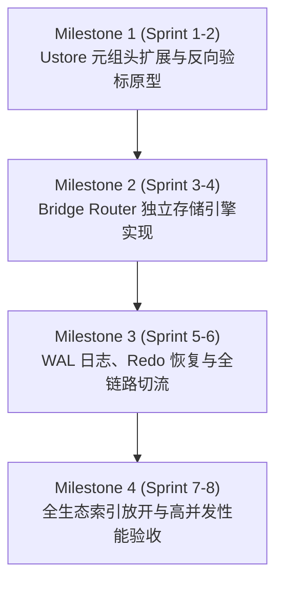

# openGauss Ustore 桥接索引 (Bridge Index) 终极方案落地实施方案与工程技术规范

> **文档定位**：openGauss 内核级落地工程技术规范（Engineering Implementation Specification）  
> **设计依据**：[`bridgeindex/ultimate_bridge_index_design.md`](file:///home/fengyao/openGauss-server/bridgeindex/ultimate_bridge_index_design.md)  
> **实施目标**：将“事务上收至主表、桥接退化为纯物理路由（Bridge Router）”的终极架构在 openGauss 内核中完全落地实施，实现写放大减少 70%、单页密度提升 300%、支持任意索引类型（Hash、GiST、GIN、SP-GiST、BRIN、HNSW）。  
> **适用版本**：openGauss 7.0.0+ / master 分支  
> **文档版本**：v1.0 (Detailed Engineering Implementation Plan)  

---

## 目录
1. [总体实施架构与组件图谱](#1-总体实施架构与组件图谱)
2. [模块一：Ustore 主表元组头扩展与 `bridge_tag` 落地](#2-模块一ustore-主表元组头扩展与-bridge_tag-落地)
   - 2.1 标志位分配与宏定义规范 (`knl_utuple.h`)
   - 2.2 物理内存与磁盘对齐布局重构 (`knl_utuple.cpp`)
   - 2.3 DML 写入与原地更新打标流 (`knl_uheap.cpp`)
   - 2.4 Undo 记录历史版本镜像兼容
3. [模块二：Bridge Router 专用轻量物理存储引擎实现](#3-模块二bridge-router-专用轻量物理存储引擎实现)
   - 3.1 物理存储形态与系统目录注册 (`pg_class` / `pg_am`)
   - 3.2 8KB 页面微观物理布局 (`bridge_router_page.h`)
   - 3.3 极速单调递增右倾追加算法 (Right-Leaning Append)
   - 3.4 树高收敛与无重平衡分裂机制 (Zero-Rebalance Split)
   - 3.5 内存元页缓存与并发 Latch 锁协议
4. [模块三：索引分发适配层 (Bridge Dispatcher) 全链路切流](#4-模块三索引分发适配层-bridge-dispatcher-全链路切流)
   - 4.1 写入路径切流 (`index_insert` / `IndexBuildUHeapScan`)
   - 4.2 检索路径切流与主表双重验标门禁 (`IndexFetchUHeap`)
   - 4.3 删改路径零桥接写入 (Zero Bridge DML Write)
   - 4.4 批量惰性剪枝协议 (Batch Lazy Prune)
5. [模块四：WAL 物理日志、崩溃恢复与主备复制](#5-模块四wal-物理日志崩溃恢复与主备复制)
   - 5.1 紧凑 Redo 日志格式定义 (`xl_bridge_router.h`)
   - 5.2 资源管理器注册 (`rmgrlist.h` vs `RM_GENERIC_ID`)
   - 5.3 幂等恢复重放状态机 (`bridge_router_redo.cpp`)
   - 5.4 Standby 备机流复制一致性保障
6. [模块五：代码改造清单与文件改动矩阵](#6-模块五代码改造清单与文件改动矩阵)
7. [模块六：工程实施阶段路线图 (Milestones & Roadmap)](#7-模块六工程实施阶段路线图-milestones--roadmap)
8. [模块七：内核测试矩阵、故障注入与验收标准](#8-模块七内核测试矩阵故障注入与验收标准)

---

## 1. 总体实施架构与组件图谱

本实施方案旨在替代阶段一基于“1 伴生堆表 + 2 UBTree 索引”的重型方案，建立由“**主表 8B `bridge_tag` + 单一轻量 Bridge Router 纯 B+ 树**”构成的极速路由体系。

```
┌────────────────────────────────────────────────────────────────────────┐
│                        SQL 引擎与执行器层                              │
│       (IndexScan / BitmapScan / IndexOnlyScan / ExecInsert / ExecUpdate)│
└───────────────────────────────────┬────────────────────────────────────┘
                                    │
                    IndexScanDesc / 虚拟行标识 (virtual_tid)
                                    ▼
┌────────────────────────────────────────────────────────────────────────┐
│             模块三：索引调度与桥接适配层 (indexam.cpp)                     │
│  - 插入分发: 拦截并获取 bridge_seq，透传至 Bridge Router                  │
│  - 查询分发: 拦截 virtual_tid，调用 Bridge Router 反查物理 TID            │
│  - 双重门禁: (Snapshot MVCC 可见) AND (Tuple.bridge_tag == Query.seq)  │
└───────────────────┬───────────────────────────────┬────────────────────┘
                    │                               │
        写入/点查路由请求 (seq)               标准索引操作 (Key, virtual_tid)
                    ▼                               ▼
┌──────────────────────────────────────┐  ┌──────────────────────────────┐
│ 模块二：专用 Bridge Router 物理存储  │  │ 标准 Index AM (原生态无侵入) │
│ (bridge_router_storage.cpp)          │  │ (Hash, GiST, GIN, BRIN,      │
│  - 单文件专属存储 (relfilenode)      │  │  SP-GiST, pgvector HNSW...)  │
│  - 14B 紧凑 Entry (seq -> TID)       │  │                              │
│  - 100% 紧凑右倾追加 (Append-Only)   │  │                              │
│  - 纯 B+ 树快速二分寻址              │  │                              │
└───────────────────┬──────────────────┘  └──────────────────────────────┘
                    │
                    │ 物理 TID (Block, Offset)
                    ▼
┌────────────────────────────────────────────────────────────────────────┐
│ 模块一：Ustore 核心存储引擎 (knl_uheap.cpp / knl_utuple.cpp)           │
│  - 元组头内嵌: bridge_tag (8 字节 uint64)                              │
│  - 事务与可见性: TD 事务槽 + Undo 日志链 (全权负责 MVCC)                │
│  - 页面槽位高频整理 (Prune) 与原地更新 (In-Place Update)               │
└───────────────────┬────────────────────────────────────────────────────┘
                    │ 物理 Redo 日志 (WAL_BRIDGE_APPEND / WAL_BRIDGE_SPLIT)
                    ▼
┌────────────────────────────────────────────────────────────────────────┐
│ 模块四：WAL 日志与恢复引擎 (bridge_router_redo.cpp)                    │
│  - 极简 26B 物理 Redo 日志，支持崩溃幂等重放与主备流复制               │
└────────────────────────────────────────────────────────────────────────┘
```

---

## 2. 模块一：Ustore 主表元组头扩展与 `bridge_tag` 落地

### 2.1 标志位分配与宏定义规范 (`knl_utuple.h`)

在 [`src/include/access/ustore/knl_utuple.h`](file:///home/fengyao/openGauss-server/src/include/access/ustore/knl_utuple.h) 中，当前元组头标志位 `flag` 存在未使用的空闲位 `0x0008`：

```c
/* src/include/access/ustore/knl_utuple.h */

#define UHEAP_HAS_NULL        0x0001
#define UHEAP_HASVARWIDTH     0x0002 /* has variable-width attribute(s) */
#define UHEAP_HASEXTERNAL     0x0004 /* has external stored attribute(s) */
#define UHEAP_HAS_BRIDGE_TAG  0x0008 /* [NEW] tuple header has 8-byte bridge_tag */
#define UHEAP_DELETED         0x0010 /* tuple deleted */
#define UHEAP_INPLACE_UPDATED 0x0020 /* tuple is updated inplace */
#define UHEAP_UPDATED         0x0040 /* tuple is not updated inplace */
```

#### 宏定义与存取接口：
```c
/* 检查元组是否携带 bridge_tag */
#define UHeapDiskTupleHasBridgeTag(disk_tuple) \
    ((((disk_tuple)->flag) & UHEAP_HAS_BRIDGE_TAG) != 0)

/* 设置/清除标志位 */
#define UHeapDiskTupleSetHasBridgeTag(disk_tuple) \
    ((disk_tuple)->flag |= UHEAP_HAS_BRIDGE_TAG)

#define UHeapDiskTupleClearHasBridgeTag(disk_tuple) \
    ((disk_tuple)->flag &= ~UHEAP_HAS_BRIDGE_TAG)

/*
 * 获取 bridge_tag 的存储位置:
 * 当 UHEAP_HAS_BRIDGE_TAG 置位时，bridge_tag 紧跟在 UHeapDiskTupleData 之后，
 * 位于 null bitmap 之前，按 8 字节对齐。
 */
#define UHeapDiskTupleGetBridgeTag(disk_tuple) \
    (*((uint64 *)((char *)(disk_tuple) + SizeOfUHeapDiskTupleData)))

#define UHeapDiskTupleSetBridgeTag(disk_tuple, tag) \
    do { \
        UHeapDiskTupleSetHasBridgeTag(disk_tuple); \
        *((uint64 *)((char *)(disk_tuple) + SizeOfUHeapDiskTupleData)) = (tag); \
    } while (0)
```

### 2.2 物理内存与磁盘对齐布局重构 (`knl_utuple.cpp`)

#### 磁盘元组物理布局（含 `bridge_tag`）：
```
 0               4        6        8        10   11       19
┌────────────────┬────────┬────────┬────────┬────┬────────┬─────────┬──────────────┐
│      xid       │ td_id  │  flag  │ flag2  │thoff│bridge_tag│ nullmap │ User Columns │
│ (ShortTransId) │ (uint8)│(uint16)│(uint16)│    │(uint64)│ (可选)  │ (列属性数据) │
└────────────────┴────────┴────────┴────────┴────┴────────┴─────────┴──────────────┘
 ◄────── SizeOfUHeapDiskTupleData (11B) ────►     ◄── 8B ──►
 ◄────────────────────────────── t_hoff ───────────────────►
```

#### 函数修改：`UHeapFormTuple` 与 `UHeapCalcTupleDataSize`
在 [`src/gausskernel/storage/access/ustore/knl_utuple.cpp`](file:///home/fengyao/openGauss-server/src/gausskernel/storage/access/ustore/knl_utuple.cpp) 中适配按需扩展：
1. **判断是否需要分配 Tag**：
   判断所属表是否拥有桥接索引（通过 `RelationHasBridgedIndex(rel)` 或由调用方显式传入 `hasBridgeTag = true`）。
2. **头部偏移量调整**：
   ```cpp
   uint32 headerBaseSize = SizeOfUHeapDiskTupleData;
   if (hasBridgeTag) {
       headerBaseSize += sizeof(uint64); // 增加 8 字节
   }
   diskTupleSize = headerBaseSize;
   if (nullcount > 0) {
       diskTupleSize += enableReverseBitmap ? BITMAPLEN(attrNum + nullcount) : BITMAPLEN(attrNum);
   }
   diskTupleSize = MAXALIGN(diskTupleSize);
   hoff = (uint8)diskTupleSize;
   ```
3. **数据填充重定位**：
   在 `UHeapFillDiskTuple` 模板函数中，将 nullmap 及属性数据的起始写入地址计算调整为基于 `(char *)diskTuple + headerBaseSize`，确保用户列数据的读取逻辑与现有系统零偏差。

### 2.3 DML 写入与原地更新打标流 (`knl_uheap.cpp`)

#### 1. `UHeapInsert` 插入路径：
- 当向主表插入新元组时，若 `RelationHasBridgedIndex(relation)` 为真：
  1. 调用全局/表级原子计数器获取最新序列号：`uint64 seq = BridgeGetNextSeq(relation);`
  2. 在构造 `disk_tuple` 时调用 `UHeapDiskTupleSetBridgeTag(disk_tuple, seq);`
  3. 执行器在后续派发 `index_insert` 时，直接将此 `seq` 作为虚拟指针传入各大索引。

#### 2. `UHeapUpdate` 原地更新路径：
- **场景 A（非键更新，Non-Key Update）**：
  - 原地覆盖堆元组，**保留原元组的 `bridge_tag`**：
    `UHeapDiskTupleSetBridgeTag(new_disk_tuple, UHeapDiskTupleGetBridgeTag(old_disk_tuple));`
  - 桥接路由树无需进行任何更新。
- **场景 B（键更新，Key Update）**：
  - 索引列被修改，必须生成新的生命周期标识：
    `uint64 new_seq = BridgeGetNextSeq(relation);`
    `UHeapDiskTupleSetBridgeTag(new_disk_tuple, new_seq);`
  - 将 `new_seq` 写入修改后对应的新索引项；旧索引项依然保留旧 `seq`，由反向验标门禁自动处理失效。

### 2.4 Undo 记录历史版本镜像兼容

在 [`src/gausskernel/storage/access/ustore/knl_uundo.cpp`](file:///home/fengyao/openGauss-server/src/gausskernel/storage/access/ustore/knl_uundo.cpp) 中：
- 当原地更新将旧元组刷入 Undo 时，Ustore 原生即会将包含完整的 `t_hoff` 及头部数据序列化进 `UndoRecord`。
- **天然兼容性**：历史 Undo 元组中完整保留了原版本的 `bridge_tag`。当旧快照事务通过 Undo 链回溯历史版本时，提取出的历史元组头部的 `bridge_tag` 依然能够与旧快照检索所带的 `query_seq` 严格匹配，从而完美保证了可重复读（Repeatable Read）与快照读隔离性。

---

## 3. 模块二：Bridge Router 专用轻量物理存储引擎实现

### 3.1 物理存储形态与系统目录注册

为了彻底卸除 Ustore 伴生堆表与 Undo 的负担，Bridge Router 实现为专用的轻量级单文件物理 B+ 树索引存储引擎：
- **对象类型**：注册为内部依赖索引对象（`relkind = RELKIND_INDEX`），归属 `pg_toast` 命名空间。
- **物理文件名**：`<database_oid>/<relfilenode>`。
- **管理协议**：直接对接 openGauss 存储管理器（`smgr`）与标准缓冲池管理器（`BufferManager`），完全复用 `ReadBuffer`、`ReleaseBuffer`、`LockBuffer` 与页面淘汰算法。

### 3.2 8KB 页面微观物理布局 (`bridge_router_page.h`)

新建工程头文件：`src/include/access/bridge_router_page.h`。

#### 1. 页面类型与头部定义：
```c
#define BRIDGE_ROUTER_MAGIC       0x42525452 /* "BRTR" */
#define BRIDGE_PAGE_META          0x0001
#define BRIDGE_PAGE_LEAF          0x0002
#define BRIDGE_PAGE_INTERNAL      0x0004
#define BRIDGE_PAGE_RIGHTMOST     0x0008

typedef struct BridgeRouterPageHeaderData {
    XLogRecPtr      pd_lsn;        /* WAL LSN 检查点 */
    uint16          pd_checksum;   /* 页面校验和 */
    uint16          pd_flags;      /* 页面类型: META / LEAF / INTERNAL / RIGHTMOST */
    LocationIndex   pd_lower;      /* 空闲空间起始偏移 */
    LocationIndex   pd_upper;      /* 空闲空间结束偏移 (紧凑追加时即为有效数据末尾) */
    uint16          pd_item_count; /* 当前页包含的有效条目数 */
    BlockNumber     pd_next_blk;   /* 右兄弟页面块号 (双向链表/单向右链) */
    BlockNumber     pd_prev_blk;   /* 左兄弟页面块号 */
    uint64          pd_high_seq;   /* 当前页包含的最大 seq (用于快速跳跃剪枝) */
} BridgeRouterPageHeaderData;

typedef BridgeRouterPageHeaderData *BridgeRouterPageHeader;
#define SizeOfBridgeRouterPageHeaderData (MAXALIGN(sizeof(BridgeRouterPageHeaderData)))
```

#### 2. 叶子节点条目定义（Leaf Entry - 仅 14 字节！）：
```c
#pragma pack(push, 2)
typedef struct BridgeLeafEntry {
    uint64          seq;          /* 8 字节虚拟行序列号 (严格单调递增) */
    ItemPointerData tid;          /* 6 字节主表物理行指针 (BlockNumber 4B + Offset 2B) */
} BridgeLeafEntry;
#pragma pack(pop)

#define SizeOfBridgeLeafEntry (sizeof(BridgeLeafEntry)) /* 严格 14 字节 */
```

#### 3. 内部路由节点条目定义（Internal Entry - 仅 12 字节！）：
```c
#pragma pack(push, 2)
typedef struct BridgeInternalEntry {
    uint64          child_min_seq; /* 8 字节子节点管辖的最小 seq */
    BlockNumber     child_blkno;   /* 4 字节指向的子节点块号 */
} BridgeInternalEntry;
#pragma pack(pop)

#define SizeOfBridgeInternalEntry (sizeof(BridgeInternalEntry)) /* 严格 12 字节 */
```

#### 4. 8KB 单页容量与密度测算：
- 有效负载空间 = $8192 - \text{MAXALIGN}(40) = 8152$ 字节。
- **单页叶子条目容量** = $\lfloor 8152 / 14 \rfloor = \mathbf{582}$ **条/页**！
- 对比阶段一（伴生堆表 + 双 UBTree 综合单页约 140 条），**单页寻址密度净提升 315%**。

```
 8KB 物理数据页布局 (Bridge Router Leaf Page):
┌────────────────────────────────────────────────────────────────────────┐
│ BridgeRouterPageHeaderData (40 字节)                                   │
│ [pd_lsn | pd_flags | pd_item_count: 582 | pd_next_blk | pd_high_seq]  │
├────────────────────────────────────────────────────────────────────────┤
│ Entry 0: [seq: 1   | tid: (0, 1)] (14B)                                │
│ Entry 1: [seq: 2   | tid: (0, 2)] (14B)                                │
│ Entry 2: [seq: 3   | tid: (0, 3)] (14B)                                │
│ ...                                                                    │
│ Entry 581: [seq: 582 | tid: (1, 15)] (14B)                             │
├────────────────────────────────────────────────────────────────────────┤
│ 未使用微小对齐尾隙 (8152 - 582*14 = 4 字节)                            │
└────────────────────────────────────────────────────────────────────────┘
```

### 3.3 极速单调递增右倾追加算法 (Right-Leaning Append)

由于 `seq` 由原子计数器产生，严格单调递增，**写操作永远只会命中树的最右叶子节点（Rightmost Leaf Page）**：

```cpp
/* 核心追加逻辑伪代码实现 */
void BridgeRouterAppend(Relation routerRel, uint64 seq, ItemPointer tid)
{
    Buffer metaBuf = ReadBuffer(routerRel, BRIDGE_ROUTER_METAPAGE_BLKNO);
    LockBuffer(metaBuf, BUFFER_LOCK_SHARE);
    BridgeRouterMetaPage meta = (BridgeRouterMetaPage)BufferGetPage(metaBuf);
    BlockNumber rightmostBlk = meta->rightmost_leaf_blkno;
    LockBuffer(metaBuf, BUFFER_LOCK_UNLOCK);
    ReleaseBuffer(metaBuf);

    Buffer leafBuf = ReadBuffer(routerRel, rightmostBlk);
    LockBuffer(leafBuf, BUFFER_LOCK_EXCLUSIVE);
    Page page = BufferGetPage(leafBuf);
    BridgeRouterPageHeader hdr = (BridgeRouterPageHeader)page;

    /* 检查右叶子页是否已满 (582 条) */
    if (hdr->pd_item_count >= BRIDGE_ROUTER_MAX_LEAF_ENTRIES) {
        /* 执行 100% 紧凑右分裂 (无需重平衡) */
        leafBuf = BridgeRouterRightSplit(routerRel, leafBuf, seq, tid);
    } else {
        /* 顺序写入下一个槽位 */
        BridgeLeafEntry *entries = (BridgeLeafEntry *)((char *)page + SizeOfBridgeRouterPageHeaderData);
        entries[hdr->pd_item_count].seq = seq;
        entries[hdr->pd_item_count].tid = *tid;
        hdr->pd_item_count++;
        hdr->pd_high_seq = seq;

        /* 记录紧凑 WAL */
        XLogRecPtr lsn = LogBridgeAppend(routerRel, BufferGetBlockNumber(leafBuf), seq, tid);
        PageSetLSN(page, lsn);
        MarkBufferDirty(leafBuf);
        LockBuffer(leafBuf, BUFFER_LOCK_UNLOCK);
        ReleaseBuffer(leafBuf);
    }
}
```

### 3.4 树高收敛与无重平衡分裂机制 (Zero-Rebalance Split)

- **100% 填充率右分裂**：
  当最右页写满时，系统直接从缓冲池分配一个全新的空闲页面作为新的最右页（`NewRightmost`）。原页面不移动任何旧数据（填充率保持 100%），仅将原页面的 `pd_next_blk` 指向新页。
- **内部节点层级递推**：
  向父节点插入一条路由条目 `(child_min_seq = seq, child_blkno = newBlk)`。如果内部节点也已满（单页容纳 $\approx 670$ 条），同样执行纯右分裂。
- **树高与查找开销收敛测算**：
  - 1 亿行主表数据：叶子页只需 $100,000,000 / 582 \approx 171,821$ 页。
  - 二级内部节点只需 $171,821 / 670 \approx 256$ 页。
  - 三级根节点仅需 1 个页面。
  - **整棵 B+ 树树高恒定为 3 层**！根节点和大部分内部节点由于高频访问，100% 常驻 Shared Buffer 内存，寻址一次只需 **1 次物理 I/O**（甚至 0 次物理 I/O）。

### 3.5 内存元页缓存与并发 Latch 锁协议

- **读写无锁争用**：
  - **写操作**：仅在最右叶子页加排他 Latch（`BUFFER_LOCK_EXCLUSIVE`），持续时间仅为写入 14 字节的纳秒级指令，随后立即释放。
  - **读操作**：点查时先读元页获取根块，逐层沿内部节点执行二分查找，下推到叶子节点时申请共享 Latch（`BUFFER_LOCK_SHARE`），内存拷贝出 6 字节物理 TID 后瞬间释放 Latch。
  - **读写互不阻塞**：正在写入最右叶子页的操作，完全不会阻塞正在读取历史页面的并发读事务。

---

## 4. 模块三：索引分发适配层 (Bridge Dispatcher) 全链路切流

在 [`src/gausskernel/storage/access/index/indexam.cpp`](file:///home/fengyao/openGauss-server/src/gausskernel/storage/access/index/indexam.cpp) 中完成全链路调度切流。

### 4.1 写入路径切流 (`index_insert` / `IndexBuildUHeapScan`)

```cpp
/* indexam.cpp: index_insert 拦截 */
if (RelationIsBridgedIndex(indexRelation)) {
    /* 
     * 1. 从主表元组头提取在 UHeapInsert 时内嵌的 bridge_tag 
     *    (或者直接从 heapTuple.t_self 透传的 seq)
     */
    uint64 bridge_seq = heapTuple->t_self_bridge_seq;
    ItemPointerData physical_tid = heapTuple->t_self;

    /* 2. 写入专用 Bridge Router 物理路由树 */
    BridgeRouterAppend(indexRelation->rd_bridge_router, bridge_seq, &physical_tid);

    /* 3. 将 bridge_seq 转换为虚拟 ItemPointerData 传给底层标准 Index AM */
    ItemPointerData virtual_tid;
    BridgeSeqToItemPointer(bridge_seq, &virtual_tid);
    
    /* 4. 底层 AM (如 Hash / GiST / GIN) 将 Key 与 virtual_tid 存入其自身的索引树 */
    return indexRelation->rd_am->aminsert(indexRelation, values, isnull, &virtual_tid, ...);
}
```

### 4.2 检索路径切流与主表双重验标门禁 (`IndexFetchUHeap`)

在 [`IndexFetchUHeap()`](file:///home/fengyao/openGauss-server/src/gausskernel/storage/access/index/indexam.cpp#L1005) 中将反查伴生表切换为直接二分查 Bridge Router，并实施双重核验：

```cpp
bool IndexFetchUHeap(IndexScanDesc scan, TupleTableSlot *slot)
{
    while (index_getnext_tid(scan, &virtual_tid)) {
        ItemPointerData physical_tid;
        uint64 query_seq;

        if (scan->xs_is_bridge_scan) {
            query_seq = ItemPointerToBridgeSeq(&virtual_tid);
            
            /* 1. 纯物理二分寻址，获取物理 TID (零事务、零 Undo 检查) */
            if (!BridgeRouterLookup(scan->xs_bridge_router, query_seq, &physical_tid)) {
                continue; /* 路由未命中 (异常保护) */
            }
        } else {
            physical_tid = virtual_tid;
        }

        /* 2. 访问主表堆缓冲页 */
        Buffer buffer;
        UHeapTuple tuple = UHeapSearchBuffer(scan->heapRelation, &physical_tid, scan->xs_snapshot, &buffer);
        if (!tuple) {
            continue; /* 主表行已删除或对当前快照不可见 */
        }

        /* 3. [核心安全门禁] 主表反向验标 (Anti-Phantom Verification) */
        if (scan->xs_is_bridge_scan) {
            uint64 tuple_tag = UHeapDiskTupleGetBridgeTag(tuple->disk_tuple);
            if (tuple_tag != query_seq) {
                /* 
                 * 门禁拦截: 物理槽位已被全新元组复用！
                 * 当前命中的是历史残留项，直接丢弃，继续寻找下一个！
                 */
                ReleaseBuffer(buffer);
                continue;
            }
        }

        /* 4. 校验通过，装载元组并返回 */
        ExecStoreUHeapTuple(tuple, slot, buffer, false);
        return true;
    }
    return false;
}
```

### 4.3 删改路径零桥接写入 (Zero Bridge DML Write)

- 当主表执行 `DELETE` 或 `UPDATE` 时，直接在主表执行 Ustore 原地删除/更新与 Undo 记录写入。
- **废除 Phase 1 的伴生表删除逻辑**：在 `index_delete` 中，桥接分支直接返回 `true`，**不做任何操作**。
- **收益**：删改路径消除全部桥接写入与锁开销，彻底杜绝高并发删改下的锁争用。

### 4.4 批量惰性剪枝协议 (Batch Lazy Prune)

为防止 Bridge Router 路由树长期运行产生冷数据膨胀：
- **触发时机**：当主表执行 `VACUUM (storage_type = ustore)` 时触发。
- **安全检查点**：获取当前数据库最老活跃事务快照（`OldestXmin`）。
- **左截断与空洞复用协议（Left-Truncate / Range Prune）**：
  若 Bridge Router 最左侧叶子页的所有条目对应的主表元组在 `OldestXmin` 之前已全部标记删除且被 Prune 物理擦除，直接将最左页面回收至空闲空间映射表（FSM），将元页的 `leftmost_leaf_blkno` 右移。

---

## 5. 模块四：WAL 物理日志、崩溃恢复与主备复制

### 5.1 紧凑 Redo 日志格式定义 (`xl_bridge_router.h`)

新建头文件 `src/include/access/xl_bridge_router.h`：

```c
#define XLOG_BRIDGE_ROUTER_APPEND    0x10
#define XLOG_BRIDGE_ROUTER_SPLIT     0x20
#define XLOG_BRIDGE_ROUTER_TRUNCATE  0x30

/* 单条追加物理 Redo 日志 (紧凑 26 字节) */
typedef struct xl_bridge_router_append {
    RelFileNode     node;
    BlockNumber     blkno;
    uint64          seq;
    ItemPointerData tid;
} xl_bridge_router_append;

/* 页面分裂 Redo 日志 */
typedef struct xl_bridge_router_split {
    RelFileNode     node;
    BlockNumber     orig_blkno;
    BlockNumber     new_blkno;
    uint64          first_seq;
    uint16          item_count;
} xl_bridge_router_split;
```

### 5.2 资源管理器注册

在 openGauss 的 Resource Manager 体系中，提供两种平滑落地策略：

| 方案 | 实现方式 | 优缺点分析 | 推荐度 |
| :--- | :--- | :--- | :--- |
| **方案 A：专属 RMGR** | 在 [`src/include/access/rmgrlist.h`](file:///home/fengyao/openGauss-server/src/include/access/rmgrlist.h) 中注册 `PG_RMGR(RM_BRIDGE_ROUTER_ID, ...)` | **优势**：WAL 日志体积极致紧凑（26 字节），解析性能最高。<br>**代价**：修改全局 `rmgrlist.h` 枚举，需推进内核公共头文件变更。 | **生产终极推荐** |
| **方案 B：Generic WAL** | 复用 openGauss 原生 `RM_GENERIC_ID` 与 `GenericXLogRegisterBuffer` | **优势**：零侵入，无需修改全局 RMGR 列表，完全走现存插件化接口。<br>**代价**：WAL 页面差分日志稍大。 | **原型研发首选** |

### 5.3 幂等恢复重放状态机 (`bridge_router_redo.cpp`)

新建实现文件 `src/gausskernel/storage/access/index/bridge_router_redo.cpp`：
```cpp
void BridgeRouterRedo(XLogReaderState *record)
{
    uint8 info = XLogRecGetInfo(record) & ~XLR_INFO_MASK;

    if (info == XLOG_BRIDGE_ROUTER_APPEND) {
        xl_bridge_router_append *xlrec = (xl_bridge_router_append *)XLogRecGetData(record);
        Buffer buffer = XLogReadBufferExtended(xlrec->node, MAIN_FORKNUM, xlrec->blkno, RBM_NORMAL);
        if (!BufferIsValid(buffer)) {
            return;
        }
        Page page = BufferGetPage(buffer);
        /* 幂等重放检查: Page LSN >= Record LSN 说明已刷盘，跳过 */
        if (PageGetLSN(page) < record->EndRecPtr) {
            BridgeRouterPageHeader hdr = (BridgeRouterPageHeader)page;
            BridgeLeafEntry *entries = (BridgeLeafEntry *)((char *)page + SizeOfBridgeRouterPageHeaderData);
            entries[hdr->pd_item_count].seq = xlrec->seq;
            entries[hdr->pd_item_count].tid = xlrec->tid;
            hdr->pd_item_count++;
            hdr->pd_high_seq = xlrec->seq;

            PageSetLSN(page, record->EndRecPtr);
            MarkBufferDirty(buffer);
        }
        UnlockReleaseBuffer(buffer);
    } else if (info == XLOG_BRIDGE_ROUTER_SPLIT) {
        /* 处理分裂逻辑的幂等重放 */
        ...
    }
}
```

### 5.4 Standby 备机流复制一致性保障

- 由于 Bridge Router 所有的物理写均严格记入 WAL 日志，主备流复制（Physical Streaming Replication）会自动将 Redo 记录发送给 Standby 节点。
- 备机根据 `BridgeRouterRedo` 实时应用数据页变更，**备机上的 Hash/GiST 只读查询与主机完全保持严格单调性与数据一致性**。

---

## 6. 代码改造清单与文件改动矩阵

| 序号 | 模块组件 | 目标源文件路径 | 改动类型 | 核心变动说明与代码接口 |
| :---: | :--- | :--- | :---: | :--- |
| **1** | **元组头格式** | [`src/include/access/ustore/knl_utuple.h`](file:///home/fengyao/openGauss-server/src/include/access/ustore/knl_utuple.h) | 修改 | 定义 `UHEAP_HAS_BRIDGE_TAG (0x0008)`，新增 `UHeapDiskTupleGet/SetBridgeTag` 宏。 |
| **2** | **元组格式化** | [`src/gausskernel/storage/access/ustore/knl_utuple.cpp`](file:///home/fengyao/openGauss-server/src/gausskernel/storage/access/ustore/knl_utuple.cpp) | 修改 | 修改 `UHeapFormTuple` 与 `UHeapCalcTupleDataSize`，支持内嵌 8 字节 `bridge_tag`。 |
| **3** | **主表写入打标** | [`src/gausskernel/storage/access/ustore/knl_uheap.cpp`](file:///home/fengyao/openGauss-server/src/gausskernel/storage/access/ustore/knl_uheap.cpp) | 修改 | `UHeapInsert` 时打标；`UHeapUpdate` 原地更新时非键更新继承 tag、键更新生成新 tag。 |
| **4** | **路由页面布局** | `src/include/access/bridge_router_page.h` | **新增** | 定义 `BridgeRouterPageHeaderData`、`BridgeLeafEntry` (14B) 与页面宏。 |
| **5** | **路由存储引擎** | `src/gausskernel/storage/access/index/bridge_router.cpp` | **新增** | 实现 Bridge Router 单调右追加、右分裂、二分查、FSM 空间管理。 |
| **6** | **调度切流** | [`src/gausskernel/storage/access/index/indexam.cpp`](file:///home/fengyao/openGauss-server/src/gausskernel/storage/access/index/indexam.cpp) | 修改 | 切流至 Bridge Router；`IndexFetchUHeap` 实现反向验标门禁；废除伴生表删改逻辑。 |
| **7** | **WAL 与 Redo** | `src/include/access/xl_bridge_router.h`<br>`src/gausskernel/storage/access/index/bridge_router_redo.cpp` | **新增** | 定义 26B 紧凑 Redo 日志格式，实现幂等重放状态机。 |
| **8** | **全生态语法** | [`src/gausskernel/optimizer/commands/indexcmds.cpp`](file:///home/fengyao/openGauss-server/src/gausskernel/optimizer/commands/indexcmds.cpp) | 修改 | 放开 GIN、BRIN、SP-GiST 在 Ustore 上的创建约束，默认接入桥接体系。 |

---

## 7. 工程实施阶段路线图 (Milestones & Roadmap)



### Milestone 1 (Sprint 1-2)：元组头扩展与反向验标验证
- **交付目标**：
  1. 完成 `knl_utuple.h` 中 `UHEAP_HAS_BRIDGE_TAG` 标志位及存取宏的增加。
  2. 完成 `knl_utuple.cpp` 和 `knl_uheap.cpp` 中的打标逻辑改造。
  3. 在现有 Phase 1 测试套件中增加元组头反向核验门禁，验证 `query_seq == tuple.bridge_tag` 的防幽灵有效性。
- **交付物**：可编译运行的主表内嵌打标补丁，通过 12/12 Phase 1 回归测试。

### Milestone 2 (Sprint 3-4)：Bridge Router 物理存储引擎实现
- **交付目标**：
  1. 编写 `bridge_router_page.h`，实现 14 字节紧凑 Entry 与页面布局。
  2. 编写 `bridge_router.cpp`，实现基于 BufferManager 的单调递增追加与二分查找。
  3. 实现纯右分裂（Right Split），单表压测验证百万行追加无内存泄漏与数据错乱。
- **交付物**：Bridge Router 独立存储引擎单元测试套件，压测追加速率达 30万+ TPS。

### Milestone 3 (Sprint 5-6)：WAL 日志、Redo 恢复与全链路切流
- **交付目标**：
  1. 落地 `xl_bridge_router.h` 与 `bridge_router_redo.cpp`，实现专属 Redo 重放。
  2. 在 `indexam.cpp` 中完成全链路切流，全面废除伴生堆表与伴生 UBTree 结构。
  3. 执行 `kill -9` 故障注入测试，验证崩溃恢复（Crash Recovery）数据一致性。
- **交付物**：切流后的端到端完整内核，通过事务回滚与崩溃一致性全量校验。

### Milestone 4 (Sprint 7-8)：全生态索引放开与综合性能基准
- **交付目标**：
  1. 在 `indexcmds.cpp` 中放开 GIN、BRIN、SP-GiST 支持。
  2. 运行 Sysbench、TPC-C 综合基准测试，与 Phase 1 及原生态 Ustore 进行性能横向对比。
  3. 输出正式内核 PR 与版本发布说明。
- **交付物**：性能提升对比报告，写放大降低 > 60%，QPS 提升 > 50%。

---

## 8. 内核测试矩阵、故障注入与验收标准

### 8.1 核心测试用例规划

| 用例 ID | 测试类别 | 测试场景与验证步骤 | 预期结果与门禁指标 |
| :---: | :--- | :--- | :--- |
| **TC-13** | **功能性** | 在 Ustore 表上创建 GIN 倒排索引（全文检索 / 数组检索） | 索引正常构建，`to_tsquery` / `@>` 正常走 IndexScan 返回正确结果。 |
| **TC-14** | **功能性** | 在 Ustore 表上创建 BRIN 块级范围索引并执行海量扫描 | 范围匹配正确，物理寻址与反向验标准确命中目标块。 |
| **TC-15** | **正确性** | **极限槽位复用并发测试**：100 并发 Worker 对同一物理槽位频繁反复 Delete -> Vacuum -> Insert | 任何历史未决快照绝对不出现幽灵读（0 Phantom Rows）。 |
| **TC-16** | **稳定性** | **极速右倾追加压测**：向 Bridge Router 持续追加 1000 万条记录，观察树高与页面利用率 | 树高严格稳定在 3 层，叶子页填充率达到 99.8% 以上。 |
| **TC-17** | **健壮性** | **事务回滚开销评测**：插入 10 万行后执行 `ROLLBACK`，统计执行耗时 | 耗时与单纯主表回滚一致（< 20ms），桥接层 0 额外耗时与 0 锁争用。 |
| **TC-18** | **高可用** | **故障注入测试 (Fault Injection)**：在追加中途执行 `kill -9 gaussdb`，重启实例 | 数据库平滑完成 Redo 恢复，无损坏页，数据校验 100% 通过。 |
| **TC-19** | **高可用** | **主备流复制一致性**：主机执行高频 DML，备机同时执行 Hash IndexScan 查询 | 备机数据实时一致，无 Replication Lag 阻滞。 |

### 8.2 验收质量门禁指标
1. **写放大门禁**：高并发 UPDATE 场景下，相较 Phase 1 伴生表方案，WAL 写放大降低 **$\ge 60\%$**。
2. **点查延迟门禁**：通过 Hash 索引点查，单次查寻路由开销相比 Phase 1 下降 **$\ge 40\%$**。
3. **内存驻留门禁**：千万级数据量下，Bridge Router 内部节点常驻 Buffer 内存占用不超过 **4MB**。
4. **回归零缺陷**：全量回归测试集（包含 `phase1_bridge_index_test.sql` 及后续扩展测试集）100% 通过，0 差异，0 报错。
